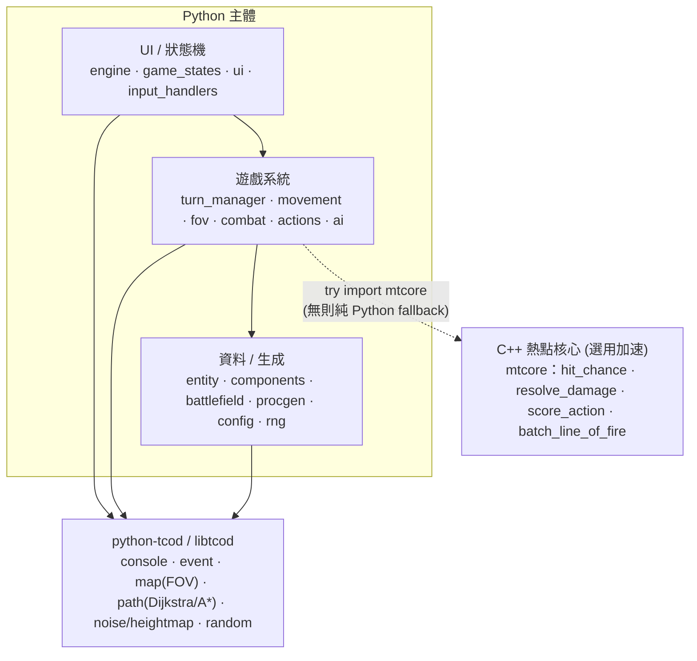

# 教學索引 — 回合制機甲戰旗（Mecha Tactics）

> 一套用 **Python（主體）+ C++（核心熱點）+ python-tcod（打底）** 做回合制機甲戰術 SRPG 的分段教學。
> 設計契約見上層 [`../SPEC.md`](../SPEC.md)；專案目標見 [`../PROJECT.md`](../PROJECT.md)。
> 程式碼起手在 [`../src/mecha_srpg/`](../src/mecha_srpg/)，C++ 核心在 [`../cpp/`](../cpp/)。

## 怎麼讀
- **只想先跑起來**：照 [`../README.md`](../README.md) 的「純 Python 路線」，`pip install tcod numpy` 後 `python -m mecha_srpg`，再回來逐章對照原始碼。
- **想理解每個系統**：依序讀 part0 → part10，每章對應 `src/` 的一組模組。
- **C++ 是選用加速**：先用純 Python 玩通，part9 再把熱點換成 C++（行為一致，只變快）。

## 章節
| # | 檔案 | 主題 | 對應模組 |
|---|------|------|---------|
| 0 | [part0_overview_and_setup.md](part0_overview_and_setup.md) | 專案總覽、混合架構、環境與建置 | — |
| 1 | [part1_window_and_loop.md](part1_window_and_loop.md) | 開窗、tileset、console、主迴圈、事件 | `main` `engine` |
| 2 | [part2_battlefield.md](part2_battlefield.md) | 戰場網格、地形、procgen 生成 | `battlefield` `procgen` `config` |
| 3 | [part3_units.md](part3_units.md) | 機甲資料模型、部署、繪製、選取 | `components` `entity` |
| 4 | [part4_turns_ap.md](part4_turns_ap.md) | 回合制（玩家/敵方階段）、AP | `turn_manager` `game_states` |
| 5 | [part5_movement.md](part5_movement.md) | 移動範圍（Dijkstra）、路徑、動畫 | `movement` |
| 6 | [part6_fov_cover.md](part6_fov_cover.md) | 視野 FOV、射線、掩體 | `fov` |
| 7 | [part7_combat.md](part7_combat.md) | 命中/傷害/熱量結算、攻擊 | `combat` `actions` |
| 8 | [part8_ai.md](part8_ai.md) | 敵方戰術 AI（候選評分、趨近） | `ai` |
| 9 | [part9_cpp_core.md](part9_cpp_core.md) | 熱點下沉 C++：pybind11 + scikit-build | `cpp/mtcore` |
| 10 | [part10_ui_winloss.md](part10_ui_winloss.md) | HUD、選單、勝負、存檔、延伸 | `ui` `game_states` |

## 架構一覽

