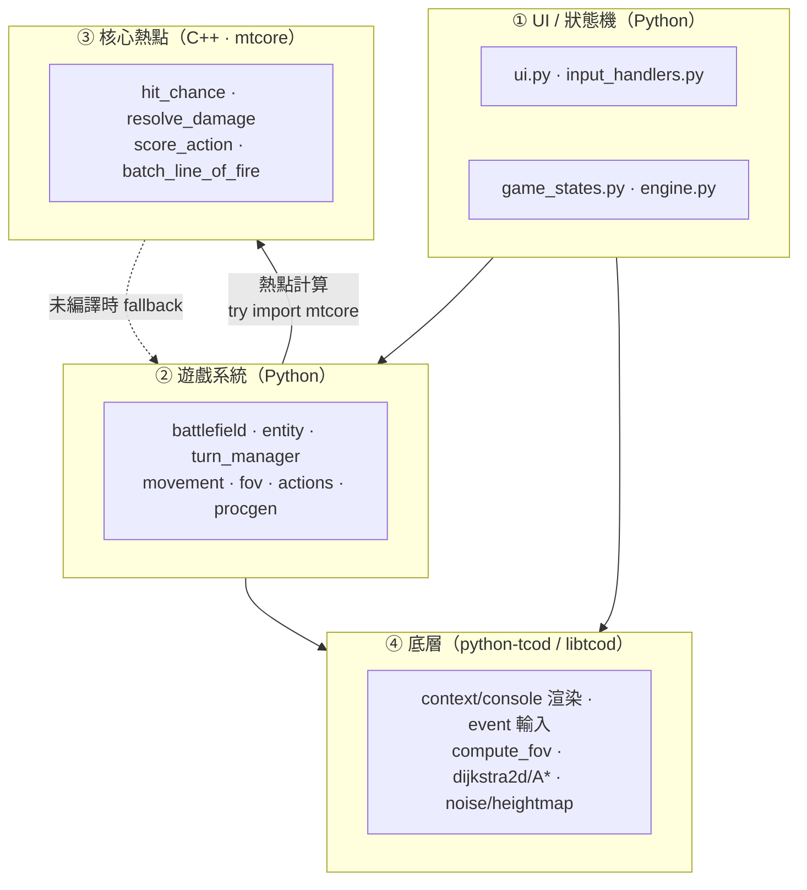

# Part 0 — 專案總覽與環境建置

> 本教學系列改編自 RogueBasin 經典「Complete roguelike tutorial using C++ and libtcod」的分章法，但把目標從地城探索 roguelike 換成**回合制機甲戰術 SRPG**。所有命名、座標慣例、數值都以本專案的 [`SPEC.md`](../SPEC.md) 為唯一真實來源。

## 0.1 我們要做什麼

做一個**回合制機甲戰術 SRPG**（Mecha Tactics）的可運行起手專案。風格參照 **Front Mission／Into the Breach／BattleTech**：在格狀戰場上部署機甲，輪流行動，靠移動、地形掩體、命中率與熱量管理擊倒對方。

最終成品（完成定義見 [`SPEC.md §12`](../SPEC.md)）：

- 開一個 80×50 的 tcod 視窗，左上是 40×30 的戰場，右側/底部是 HUD。
- 開場部署雙方機甲（玩家 vs 敵方）。
- 玩家用方向鍵移動游標、`M` 進入移動模式、`F` 攻擊、`Space` 結束單位、`E` 結束我方回合。
- 每個單位每回合有 `AP_PER_TURN = 2` 點行動點；移動消耗 1 AP、攻擊消耗武器 `ap_cost`。
- 命中率受射程、掩體、迴避、熱量影響；過熱會掉結構並降命中。
- 敵方有戰術 AI（趨近、找掩體、開火）。
- 一方全滅即分出勝負。

**重點：即使沒有編譯 C++，整個遊戲也要能完整遊玩**（走純 Python fallback）。C++ 只是後期把熱點換上去加速。

## 0.2 混合架構（核心賣點）

這個專案最值得學的不是「又一個 roguelike 教學」，而是一套**Python 主體 + C++ 熱點 + python-tcod 打底**的混合架構。各層職責切得很乾淨：



為什麼這樣分層？

| 層 | 語言 | 為什麼放這裡 |
|----|------|--------------|
| ① UI／狀態機 | Python | 改動最頻繁、邏輯瑣碎、不吃效能，Python 開發速度最划算。 |
| ② 遊戲系統 | Python | 規則、資料流、流程控制；可讀性 > 速度。座標慣例（[`SPEC §2`](../SPEC.md)）統一在此封裝。 |
| ③ 核心熱點 | C++（`mtcore`） | 命中/傷害數學、AI 對每個候選格×每個目標的評分、批次視線——這些是 AI 思考時被呼叫成千上萬次的內迴圈，下沉到 C++ 才划算。 |
| ④ 底層 | python-tcod | 渲染、輸入、FOV、尋路、地圖生成全部免費拿到，且本身就是 C 寫的 libtcod。 |

**漸進原則（鐵則，[`SPEC §4`](../SPEC.md)）**：所有呼叫 `mtcore` 之處都包在

```python
try:
    import mtcore
except ImportError:
    mtcore = None  # 改用 combat._py_* 純 Python 版
```

之後，確保「沒編 C++ 也能玩」。C++ 與 Python fallback 的**數學公式必須完全一致**（[`SPEC §7`](../SPEC.md)），這樣加不加速行為都相同。

## 0.3 為何選 python-tcod

[python-tcod](https://github.com/libtcod/python-tcod) 是 libtcod 的 Python 綁定，對這個專案來說它一次解決了好幾個剛需：

- **統一的 numpy 介面**：console 是一塊 numpy structured array（`ch`/`fg`/`bg`），地圖、成本、透明度全是 numpy 陣列，跟我們所有網格資料（[`SPEC §2`](../SPEC.md)，一律 `[y, x]` row-major）天然契合，不用在資料結構之間反覆轉換。
- **免費拿到演算法**：
  - `tcod.map.compute_fov` — 視野 FOV（part6 掩體/視線）。
  - `tcod.path.dijkstra2d` / `tcod.path.SimpleGraph` — Dijkstra 距離場與 A* 尋路（part5 移動範圍）。
  - `tcod.noise` / heightmap — 程序生成戰場地形（part2 procgen）。
  - `tcod.random.Random` — 可重現亂數（[`rng.py`](../src/mecha_srpg/rng.py)）。
- **底層就是 C**：libtcod 本體是 C，這些演算法已經夠快，我們只需要把「遊戲特有的熱點」（命中/評分）自己再下沉到 C++。

換句話說：python-tcod 負責「通用底層」，`mtcore` 負責「我們遊戲特有的數學熱點」，Python 負責「黏合與規則」。

## 0.4 環境準備

### 先讓純 Python 版跑起來（必做）

只要 Python 3.10+ 與兩個套件就能玩，**不需要任何編譯器**：

```bash
python --version          # 需 3.10 以上
pip install tcod numpy
```

之後在專案根目錄（可開發安裝）：

```bash
pip install -e .
python -m mecha_srpg       # 走純 Python fallback，照樣能玩
```

> 建議先把純 Python 版跑通、玩明白，再回頭碰 C++。C++ 是**選用加速**，不是入門門檻。

### C++ 加速（選用，part9 才需要）

要編 `mtcore` 才需要 C++ 工具鏈（[`SPEC §1/§4`](../SPEC.md)）：

- C++17 編譯器（Windows：Visual Studio Build Tools；Linux：g++；macOS：clang）。
- 建置由 `pyproject.toml`（**scikit-build-core**）驅動，內部跑 **CMake** + **pybind11**。

```bash
pip install -e .           # 偵測到 cpp/ 與編譯器時會一併編譯 mtcore
```

編譯成功後，`import mtcore` 不再 `ImportError`，戰鬥/AI 數學自動由 C++ 計算，行為與 fallback 一致（[`SPEC §12`](../SPEC.md)）。part9 會完整講 pybind11 綁定與前後加速對比。

## 0.5 專案目錄導覽

對照 [`SPEC §3/§4/§11`](../SPEC.md) 的樹，整個專案長這樣：

```text
mecha-srpg/
├── pyproject.toml          # scikit-build-core 建置設定（含 C++）
├── CMakeLists.txt          # 頂層 CMake（驅動 cpp/）
├── requirements.txt        # tcod / numpy
├── SPEC.md                 # 設計契約（唯一真實來源）
├── src/mecha_srpg/         # Python 遊戲套件
│   ├── __init__.py         # 版本與公開匯出
│   ├── config.py           # 所有常數：尺寸/顏色/地形/平衡數值
│   ├── rng.py              # 可重現亂數（tcod.random.Random 包裝）
│   ├── components.py       # 純資料：Stats / Weapon / Armor / Pilot
│   ├── entity.py           # Entity 基底；MechUnit
│   ├── battlefield.py      # 地形網格 + 透明/成本陣列 + tcod 介接
│   ├── procgen.py          # noise/heightmap 生成戰場與部署點
│   ├── turn_manager.py     # 玩家/敵方階段、每單位 AP
│   ├── movement.py         # 移動範圍（Dijkstra 距離場）、路徑
│   ├── fov.py              # 視野與射線/掩體
│   ├── combat.py           # 命中/傷害結算（呼叫 mtcore + fallback）
│   ├── actions.py          # MoveAction / AttackAction / WaitAction / OverwatchAction
│   ├── ai.py               # HostileAI（呼叫 mtcore 評分）
│   ├── game_states.py      # DeployState / PlayerTurnState / EnemyTurnState / GameOverState
│   ├── input_handlers.py   # tcod.event → Action 映射
│   ├── ui.py               # HUD、游標、面板、高亮、選單
│   ├── engine.py           # Engine：持有全域狀態，驅動 render / handle_events
│   └── main.py             # 進入點：建 tcod context/tileset + 主迴圈
├── cpp/
│   ├── CMakeLists.txt      # pybind11_add_module(mtcore mtcore.cpp)
│   └── mtcore.cpp          # pybind11 模組：hit_chance / resolve_damage / score_action / batch_line_of_fire
└── docs/                   # 本教學（part0–part10）
```

每個 .py 檔頂部都有一段繁體中文 docstring，標明用途與對應教學 part（[`SPEC §10`](../SPEC.md)）。

## 0.6 與 RogueBasin 經典教學的關係

RogueBasin 的「Complete roguelike tutorial using C++ and libtcod」是 libtcod 圈子的入門經典，它把一個 roguelike 拆成「開窗→地圖→實體→FOV→AI→物品→存檔→UI」這種循序漸進的章節。我們**沿用它「一章一個可運行里程碑」的教學節奏**，但內容改編為 SRPG：

| RogueBasin 經典章節（roguelike） | 本專案對應章節（SRPG） |
|--------------------------------|------------------------|
| 開窗與主迴圈 | part1：開窗、tileset、console、主迴圈、事件 |
| 地圖與地形 | part2：戰場網格、地形、procgen |
| 角色實體 | part3：機甲資料模型、部署、繪製 |
| 回合（即時/能量） | part4：回合制（玩家/敵方階段）、AP、TurnManager |
| FOV | part5/part6：移動範圍、視野、掩體 |
| AI | part8：敵方戰術 AI |
| 戰鬥 | part7：命中/傷害/熱量結算 |
| UI / 存檔 | part10：HUD、選單、勝負、延伸 |

最大差異：roguelike 是**單一角色即時探索**，SRPG 是**多單位、回合階段、AP、命中率與掩體**——所以我們額外多了 `turn_manager`、`actions`、`ai`、以及把戰鬥數學下沉到 C++ 的 part9。

## 本章完成後你應該能…

- 說清楚這是一個什麼樣的遊戲、最終成品長什麼樣。
- 講出混合架構四層（UI/狀態 → 遊戲系統 → C++ 熱點 → tcod）各自的職責與「為何這樣分」。
- 解釋為何選 python-tcod，以及它免費提供了哪些演算法。
- 用 `pip install tcod numpy` 備好純 Python 環境，知道 C++ 只是選用加速、「先純 Python 跑起來」。
- 對照 [`SPEC`](../SPEC.md) 認得專案目錄裡每個模組的位置與職責。

## 下一章

[Part 1 — 開窗與主迴圈](part1_window_and_loop.md)：載入 tileset、建立 tcod context 與 console、寫出 clear→render→present→`tcod.event.wait()` 的主迴圈，做出第一個「開窗顯示 `@` 並能 Esc 離開」的可跑範例。
