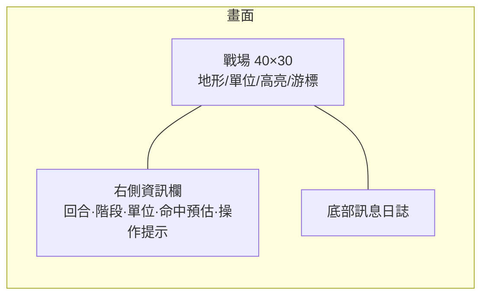

# Part 10 — UI、勝負與收尾

> 對應原始碼：`ui.py`、`game_states.py`（`GameOverState`）、`engine.py`。
> 前一章：[part9 C++ 核心](part9_cpp_core.md)　·　全系列回 [教學索引](README.md)

## 本章目標
把畫面與流程收尾：HUD、高亮、命中預估、勝負判定、存檔，以及這個起手專案之後能往哪長。

## 1. HUD（`ui.draw_hud`）

版面（SPEC §8）：戰場佔左上 `MAP_W×MAP_H`；右側為資訊欄；底部為訊息日誌。



資訊欄內容：`回合 N`、`階段`（部署/我方/敵方/結束）、選取單位的`結構/AP/熱量/武器`、攻擊模式的`命中預估`、操作鍵提示。全部用 `console.print` + `console.draw_rect` 填色塊，**不畫框線字元**（SPEC §7 鐵則）。

## 2. 高亮（背景色疊加，不用框線）

- 移動範圍：藍底 `COLOR_MOVE_RANGE`。
- 射程/可攻擊：紅底 `COLOR_ATTACK_RANGE`。
- 游標：黃底 `COLOR_CURSOR`（前景轉黑確保字清楚）。

```python
def highlight_cells(console, cells, color):
    bg = console.bg          # order="F" → [x, y]
    for (cx, cy) in cells:
        if 0 <= cx < console.width and 0 <= cy < console.height:
            bg[cx, cy] = color
```

## 3. 命中預估

攻擊模式下移動游標，`PlayerTurnState._update_hit_preview()` 對游標下的敵方單位算 `combat.hit_chance(...)`，HUD 顯示 `xx%`，讓玩家在開火前評估。失敗時顯示 `—`（容錯）。

## 4. 勝負（`TurnManager.check_victory`）

```python
def check_victory(self):
    if not any(u.faction == Faction.ENEMY and u.alive for u in self.units):
        return Faction.PLAYER     # 敵全滅 → 玩家勝
    if not any(u.faction == Faction.PLAYER and u.alive for u in self.units):
        return Faction.ENEMY      # 我全滅 → 敗
    return None
```
玩家行動後、敵方回合結束後各判定一次；分出勝負即切 `GameOverState`（Enter 重開、Esc 離開）。

## 5. 存檔（概念）

戰局狀態（units、battlefield.tiles、turn_count、current_faction）是純資料，最簡單用 `pickle`：
```python
import pickle
def save(engine, path):
    with open(path, "wb") as f:
        pickle.dump({"units": engine.units, "tiles": engine.battlefield.tiles,
                     "turn": engine.turn_manager.turn_count}, f)
```
> 注意：`pickle` 不可載入不受信任的檔案（可執行任意程式碼）；對外分享的存檔改用 `json` + 自訂序列化，並把 numpy 陣列轉 list。tcod 物件（context/console）不要進存檔。

## 6. 後續延伸（這顆種子能長成什麼）

- **技能/狀態效果**：過載衝刺、煙幕、EMP（命中/移動 debuff）。
- **ZoC 控制區**：敵格鄰近提高移動成本（見 [part5](part5_movement.md) 鉤子）。
- **守望反擊**：`actions.trigger_overwatch` 已留鉤子，接上「敵入射程逐格觸發」。
- **地形破壞**：飛彈打掉建物 → 改 `battlefield.tiles` 與衍生成本/透明陣列。
- **戰役層**：多場戰鬥 + 機甲改裝編成（沿用 components 資料模型）。
- **更多熱點下沉 C++**：把整個 AI 候選迴圈批次交給 `mtcore`（[part9](part9_cpp_core.md)）。

## 7. 收尾檢查表（對照 SPEC §12）

- [ ] `pip install tcod numpy` 後 `python -m mecha_srpg` 可開窗、部署、移動、攻擊、分勝負（純 Python）。
- [ ] 依 `INTEGRATION_NOTES.md` 統一 `ai.py`/`movement`/`actions`/`combat`/`fov` 介面 → 敵方 AI 完全生效。
- [ ] 編譯 `mtcore` 後行為一致、戰鬥/AI 數學由 C++ 計算。
- [ ] 11 章教學與 `src/` 命名一致。

## 本章完成後你應該能…
- 畫出完整 HUD 與三種高亮、命中預估。
- 判定勝負並處理重開/離開。
- 規劃存檔與後續系統的擴充點。

全系列完 → 回 [教學索引](README.md)　·　設計契約 [SPEC.md](../SPEC.md)　·　待整合 [INTEGRATION_NOTES.md](../INTEGRATION_NOTES.md)
