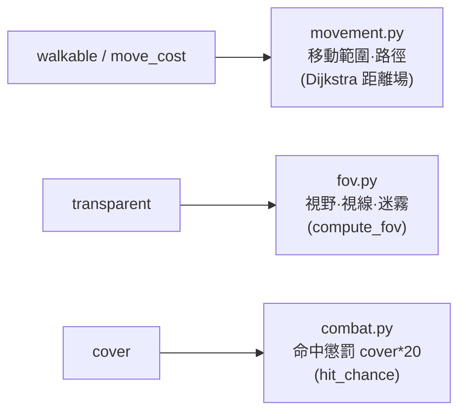
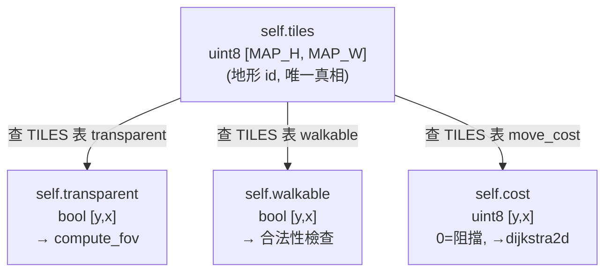

# Part 2 — 戰場與地形

> 對應 SPEC §2（座標慣例）、§6（地形表）、模組 `battlefield.py` 與 `procgen.py`。
>
> 本章把「一張機甲戰場」拆成三件事：(1) 用什麼資料結構存地形、(2) 怎麼把這份資料餵給 tcod 的演算法（FOV／Dijkstra）、(3) 怎麼用雜訊程序化生成一張可玩的戰場並選出雙方部署點。前置章節：`part1_window_and_loop.md`（已能開窗、有 `console` 與主迴圈）。

---

## 2.1 為什麼用 numpy `[y, x]` 網格 + 地形 id

一張 40×30 的戰場，每格存的是「這格是哪種地形」。我們不為每格建一個物件，而是存一個**整數 id**（`0=平地`、`1=樹林`…，見 §6 / `config.py:92-97`），所有地形屬性查表得到。理由：

- **記憶體與速度**：整張地圖就是一個 `numpy` 的 `uint8` 陣列，`compute_fov`／`dijkstra2d` 都吃 numpy 陣列，可整批向量化處理，不必逐格走 Python 迴圈。
- **資料與行為分離**：地形「長怎樣／能不能走／擋不擋視線」全部集中在 `config.TILES` 表（`config.py:100-107`），地圖陣列只記 id。改平衡只改一張表。

座標慣例是**鐵則**（SPEC §2），務必背下來：

| 概念 | 寫法 | 說明 |
|------|------|------|
| 邏輯座標 | `(x, y)` | x=橫、y=縱，原點左上。所有模組對外只用這個 |
| numpy 索引 | `arr[y, x]` | row-major，第一軸是 row(y)、第二軸是 col(x) |
| 建立陣列 | `np.zeros((MAP_H, MAP_W), ...)` | shape 是 `(高, 寬)` = `(MAP_H, MAP_W)` |
| 成本語意 | `0`=阻擋、正整數=進入成本 | 與 tcod `dijkstra2d` 一致（§2 鐵則） |

> **單一吸收點原則（SPEC §2）**：tcod 各 API 對座標的期待不完全一致（有的吃 `(x, y)`、有的吃 `[y, x]` 或 `pov=(row, col)`）。我們把所有「座標↔索引」的轉換**只放在 `battlefield.py`**，其他模組（movement / fov / ai）一律只用 `(x, y)`，不直接碰 numpy 索引方向。

---

## 2.2 地形屬性表：每個欄位影響哪個系統

直接引 SPEC §6（與 `config.py:100-107` 完全一致）：

| id | 名稱 | walkable | transparent | move_cost | cover | char | 用途直覺 |
|----|------|----------|-------------|-----------|-------|------|---------|
| 0 | PLAIN 平地 | T | T | 1 | 0 | `.` | 開闊地，好走但無遮蔽 |
| 1 | FOREST 樹林 | T | F | 2 | 1 | `♣` | 擋視線、給掩體、難行 |
| 2 | RUBBLE 瓦礫 | T | T | 2 | 1 | `%` | 不擋視線但給掩體、難行 |
| 3 | BUILDING 建物 | F | F | 0 | 2 | `#` | 不可走、擋視線、最高掩體 |
| 4 | WATER 水域 | F | T | 0 | 0 | `~` | 不可走但透視，純地形屏障 |
| 5 | HILL 高地 | T | T | 2 | 1 | `^` | 制高點，給掩體、難行 |

**四個欄位各自只服務一個系統**，分清楚不要混用：



- **walkable / move_cost** → 移動（part5）。鐵則：`move_cost=0` 等同不可走（與 §2 成本陣列「0=阻擋」一致），所以建物、水域 `move_cost=0`。可走地形 `move_cost≥1`，數字越大越「黏腳」（樹林/瓦礫/高地都是 2）。
- **transparent** → 視野與視線（part6）。樹林、建物擋視線（`transparent=False`）；瓦礫雖難走但看得穿（`transparent=True`）。這就是「瓦礫能躲子彈卻看得見你、樹林連看都看不到」的差別。
- **cover** → 命中懲罰（part7）。`combat._py_hit_chance` 內 `cover_pen = cover * COVER_PENALTY_PER_LEVEL`（每級 -20，見 `combat.py:73`、`config.py:148`）。建物 cover=2 → -40 命中，是最硬的掩體。
- **char / color** → 渲染（本章 2.6）。

> 注意 `walkable` 與 `move_cost=0` 是冗餘但刻意的：`walkable` 給人讀（語意），`move_cost` 給 tcod 的成本陣列用（演算法）。兩者由同一張表填，保證不會打架。

---

## 2.3 `Battlefield` 類設計：一份地形 + 三份衍生陣列

核心想法：**地形 id 陣列是唯一真相**，FOV 要的 `transparent`、移動要的 `walkable` / `cost` 都從它**衍生（derive）**出來。地形一變，重算衍生陣列即可。



`battlefield.py` 的骨架（命名與 SPEC §3 一致；以查表向量化建衍生陣列）：

```python
"""battlefield.py — 地形網格 + 衍生陣列 + tcod 介接（SPEC §2 / §6）。

唯一真相是 self.tiles（地形 id）；transparent / walkable / cost 皆由它衍生。
本檔是「座標 (x,y) ↔ numpy 索引 [y,x]」差異的唯一吸收點（SPEC §2）。
"""
from __future__ import annotations

import numpy as np

from . import config


class Battlefield:
    """戰場：地形 id 陣列 + 供 tcod 用的衍生透明/可走/成本陣列。"""

    def __init__(self, width: int = config.MAP_W, height: int = config.MAP_H) -> None:
        self.width = width      # 對外用 (x, y)：width 對應 x 軸
        self.height = height
        # 唯一真相：地形 id，shape=(高, 寬)=(MAP_H, MAP_W)（SPEC §2）
        self.tiles = np.full((height, width), config.TILE_PLAIN, dtype=np.uint8)
        # 已探索遮罩（迷霧用，part6 啟用）；先建好欄位
        self.explored = np.zeros((height, width), dtype=bool)
        self._rebuild_derived()

    # --- 衍生陣列：地形 id → 屬性，向量化查表（避免逐格 Python 迴圈）---
    def _rebuild_derived(self) -> None:
        """由 self.tiles 重算 transparent / walkable / cost。

        作法：先建長度 = 地形種類數的「屬性查找表」，再用 fancy index
        `lut[self.tiles]` 一次把整張 id 陣列映射成屬性陣列。
        """
        n = config.NUM_TILE_TYPES
        transp_lut = np.zeros(n, dtype=bool)
        walk_lut = np.zeros(n, dtype=bool)
        cost_lut = np.zeros(n, dtype=np.uint8)
        for tid, tile in config.TILES.items():
            transp_lut[tid] = tile.transparent
            walk_lut[tid] = tile.walkable
            cost_lut[tid] = tile.move_cost      # 0 = 不可走（§2 鐵則）

        # lut[self.tiles]：以地形 id 當索引，一次映射整張地圖（向量化）
        self.transparent = transp_lut[self.tiles]   # → tcod.map.compute_fov
        self.walkable = walk_lut[self.tiles]
        self.cost = cost_lut[self.tiles]            # → tcod.path.dijkstra2d

    # --- 座標封裝（其他模組只用 (x, y)，索引方向差異在此吸收，SPEC §2）---
    def in_bounds(self, x: int, y: int) -> bool:
        """(x, y) 是否在地圖範圍內。"""
        return 0 <= x < self.width and 0 <= y < self.height

    def tile_at(self, x: int, y: int) -> config.Tile:
        """取 (x, y) 格的地形屬性（注意內部以 [y, x] 索引）。"""
        return config.get_tile(int(self.tiles[y, x]))

    def is_walkable(self, x: int, y: int) -> bool:
        """(x, y) 是否可走（界內且地形可走）。"""
        return self.in_bounds(x, y) and bool(self.walkable[y, x])

    def cover_at(self, x: int, y: int) -> int:
        """(x, y) 格地形掩體等級（0/1/2），供 combat 命中懲罰。"""
        return self.tile_at(x, y).cover

    def set_tile(self, x: int, y: int, tile_id: int) -> None:
        """設定單格地形 id；procgen 也可直接寫 self.tiles 再呼叫 _rebuild_derived。"""
        self.tiles[y, x] = tile_id
```

要點回顧：

- `self.tiles` 是 `(MAP_H, MAP_W)` 的 `uint8`，**第一軸是 y**。任何 `[y, x]` 索引都封在本類內。
- 三個衍生陣列用「查找表 + fancy index」一次算完：`transp_lut[self.tiles]` 把每個 id 換成對應布林/成本。這就是向量化——沒有任何 `for y: for x:`。
- `self.cost` 直接可餵 `tcod.path.dijkstra2d`（part5）：`0` 自然代表建物/水域的阻擋，正整數是進入成本。`self.transparent` 直接可餵 `tcod.map.compute_fov`（part6）。

> **為什麼不存 `config.Tile` 物件陣列？** numpy 不擅長存任意 Python 物件（會退化成 `object` dtype，失去向量化）。存 id + 查表，才能把整張地圖交給 tcod 的 C 實作一次算完。

---

## 2.4 procgen：用雜訊生出一張戰場

目標：給一個種子，產出 `self.tiles` 與雙方部署點。流程沿用本 repo 的 **world_gen cookbook**（[`analysis/python-tcod/tutorial/world_gen_cookbook.md`](../../../pas/analysis/python-tcod/tutorial/world_gen_cookbook.md)）的「種子 → 雜訊高度場 → 閾值切地形 → 灑特徵 → 取點」管線，但縮小到 40×30 的戰場尺度。


### 2.4.1 高度場（向量化取樣，不逐格）

cookbook 反模式第 1 條：**不要逐點 `noise.get_point()`**，用 `tcod.noise.grid()` 一次產生整網格索引再 `noise[...]` 取樣（cookbook §2 路線 A）。亂數源用本專案的 `rng.py` 單例（`get_rng().tcod_random` 取底層 `tcod.random.Random`，符合 cookbook §1「確定性生成不能用標準庫 random」）。

```python
"""procgen.py — 用 tcod noise 生成戰場地形與部署點（SPEC §2 / §6）。

管線參考本工作區 world_gen cookbook：
種子 → SIMPLEX/FBM 高度場 → numpy 閾值切水/平地/高地 → 灑樹林/瓦礫/建物 → 取部署點。
全程向量化（grid() 取樣），不逐格（cookbook 反模式 1）。
"""
from __future__ import annotations

from typing import List, Tuple

import numpy as np
import tcod.noise

from . import config
from .battlefield import Battlefield
from .rng import Rng, get_rng

# 高度閾值：低於 WATER_LEVEL 為水，高於 HILL_LEVEL 為高地，其餘為平地
WATER_LEVEL = 0.32
HILL_LEVEL = 0.68


def _height_field(rng: Rng, w: int, h: int, scale: float = 0.12) -> np.ndarray:
    """產生 [0,1) 高度場，shape=[h, w]（[y, x]）。"""
    # tcod.noise.Noise：SIMPLEX 演算法 + FBM 實作 = 自然起伏地形（cookbook §2）
    noise = tcod.noise.Noise(
        dimensions=2,
        algorithm=tcod.noise.Algorithm.SIMPLEX,
        implementation=tcod.noise.Implementation.FBM,
        octaves=4,
        lacunarity=2.0,
        hurst=0.5,
        seed=rng.tcod_random,          # 傳 tcod.random.Random 以鎖定結果
    )
    # grid(shape=(h, w), scale)：向量化稀疏索引；noise[...] 一次取樣整張
    samples = noise[tcod.noise.grid(shape=(h, w), scale=scale)]
    return (samples + 1.0) * 0.5       # float32 -1~1 → 0~1
```

### 2.4.2 閾值映射到水／平地／高地

純 numpy 布林遮罩切三層（cookbook §2「numpy 閾值分類」）：

```python
def _base_terrain(height: np.ndarray) -> np.ndarray:
    """高度場 → 基礎地形 id 陣列（水/平地/高地）。"""
    tiles = np.full(height.shape, config.TILE_PLAIN, dtype=np.uint8)
    tiles[height < WATER_LEVEL] = config.TILE_WATER     # 低地積水（不可走）
    tiles[height > HILL_LEVEL] = config.TILE_HILL       # 高地（難走、給掩體）
    return tiles
```

### 2.4.3 灑樹林／瓦礫／建物

再生**第二張獨立雜訊**當「植被/破壞密度」場（不同種子，cookbook §2 多場分區作法），只在「平地」上灑特徵，避免覆蓋掉水域與高地的地貌：

```python
def _scatter_features(rng: Rng, tiles: np.ndarray, scale: float = 0.22) -> None:
    """在平地上以第二張雜訊灑樹林/瓦礫，再隨機點綴少量建物（就地修改 tiles）。"""
    h, w = tiles.shape
    veg = tcod.noise.Noise(
        2, tcod.noise.Algorithm.SIMPLEX, tcod.noise.Implementation.FBM,
        octaves=3, seed=rng.tcod_random,
    )
    field = (veg[tcod.noise.grid((h, w), scale)] + 1.0) * 0.5

    plain = tiles == config.TILE_PLAIN
    # 高密度區→樹林，中密度區→瓦礫（皆 move_cost=2、cover=1）
    tiles[plain & (field > 0.66)] = config.TILE_FOREST
    tiles[plain & (field > 0.55) & (field <= 0.66)] = config.TILE_RUBBLE

    # 少量建物（cover=2 的硬掩體）：在剩餘平地上隨機點幾棟
    plain_idx = np.argwhere(tiles == config.TILE_PLAIN)   # [[y, x], ...]
    n_buildings = max(2, (w * h) // 200)
    if len(plain_idx) >= n_buildings:
        pick = rng.sample(range(len(plain_idx)), n_buildings)
        for i in pick:
            y, x = plain_idx[i]
            tiles[y, x] = config.TILE_BUILDING
```

> 用 `np.argwhere` 取出所有平地座標再 `rng.sample`（`rng.py:64`）抽不重複格——抽樣也走可重現 RNG，種子相同就重現整張地圖。

### 2.4.4 部署點選取

機甲戰旗的部署：玩家在**左側**、敵方在**右側**。從各自半邊挑「可走」格當部署點（避開水/建物），數量依需求：

```python
def _pick_deploy_points(
    rng: Rng, bf: Battlefield, count: int, side: str
) -> List[Tuple[int, int]]:
    """從某一側挑 count 個可走格當部署點，回傳 [(x, y), ...]。"""
    half = bf.width // 3
    if side == "left":
        xs = range(0, half)
    else:  # right
        xs = range(bf.width - half, bf.width)

    candidates = [
        (x, y) for y in range(bf.height) for x in xs if bf.is_walkable(x, y)
    ]
    if len(candidates) < count:
        # 後備：放寬到全圖可走格（罕見，地形太擠時）
        candidates = [
            (x, y) for y in range(bf.height)
            for x in range(bf.width) if bf.is_walkable(x, y)
        ]
    return rng.sample(candidates, count)
```

### 2.4.5 串起來：`generate_battlefield`

```python
def generate_battlefield(
    seed: int | None = None,
    player_count: int = 3,
    enemy_count: int = 3,
) -> Tuple[Battlefield, List[Tuple[int, int]], List[Tuple[int, int]]]:
    """生成一張戰場與雙方部署點。

    回傳 (battlefield, player_spawns, enemy_spawns)；座標皆 (x, y)。
    供 procgen → game_states.DeployState 把雙方機甲放上去（part3）。
    """
    rng = get_rng() if seed is None else Rng(seed)
    bf = Battlefield(config.MAP_W, config.MAP_H)

    height = _height_field(rng, bf.width, bf.height)
    bf.tiles = _base_terrain(height)
    _scatter_features(rng, bf.tiles)
    bf._rebuild_derived()          # 地形改完，重算 transparent/walkable/cost

    player_spawns = _pick_deploy_points(rng, bf, player_count, "left")
    enemy_spawns = _pick_deploy_points(rng, bf, enemy_count, "right")
    return bf, player_spawns, enemy_spawns
```

> 改完 `bf.tiles` 一定要 `bf._rebuild_derived()`，否則 `walkable`/`transparent`/`cost` 還停在初始全平地的狀態——這是衍生陣列模式最容易踩的坑。

---

## 2.5 可跑的離線驗證片段

procgen 不需要開窗（cookbook 反模式 6：生成階段不碰 context/console），可在無頭環境直接驗證地形比例與部署點：

```python
from mecha_srpg import procgen

bf, p_spawns, e_spawns = procgen.generate_battlefield(seed=1234)
import numpy as np
ids, counts = np.unique(bf.tiles, return_counts=True)
for tid, c in zip(ids, counts):
    print(f"{procgen.config.get_tile(tid).name:8s}: {c} 格")
print("可走格比例:", bf.walkable.mean())
print("玩家部署點:", p_spawns)
print("敵方部署點:", e_spawns)
```

種子固定 → 每次輸出完全一致，方便回歸測試與「重抽到滿意的地圖」。

---

## 2.6 渲染地形：背景色 + char

把地形畫到 `console`：每格用地形的 `char` 當前景字元、`color` 當前景色，背景可用較暗的同系色（讓字元浮出來）。tcod 的 `console.rgb` 是 `[y, x]` 的結構化陣列，能整批寫入。

```python
def render_battlefield(console, bf: Battlefield) -> None:
    """把戰場地形畫到 console（SPEC §8 顯示）。

    座標：console.rgb 是 [y, x]，與 bf.tiles 同向，可直接整批索引。
    """
    # 逐地形種類整批上色（種類少，比逐格快很多）
    for tid, tile in config.TILES.items():
        mask = bf.tiles == tid                      # 該地形的所有格 [y, x]
        console.rgb["ch"][mask] = ord(tile.char)    # 前景字元
        console.rgb["fg"][mask] = tile.color        # 前景色
        # 背景：地形色壓暗，做出層次（避免與單位前景色搶眼）
        dark = tuple(c // 4 for c in tile.color)
        console.rgb["bg"][mask] = dark
```

> 渲染同樣**按地形種類整批**處理（6 種 → 6 次遮罩寫入），而非逐格 `console.print`。單位與 UI 高亮（移動藍、射程紅、游標黃框）會疊在這層之上，細節在 part3（單位）與 ui 章。

### 迷霧／已探索預告

`Battlefield.explored` 欄位已預留（2.3 的 `__init__`）。part6 啟用 FOV 後，渲染會分三態：

- **可見（visible）**：本回合 `compute_fov` 為 True 的格，正常色顯示。
- **已探索（explored）**：看過但目前不可見，以壓暗色顯示地形（記得地貌，但看不到單位）。
- **未探索**：全黑不畫。

渲染時用 `bf.explored |= visible` 累積（cookbook §6），可見用亮色、僅探索用暗色——這層疊加邏輯留到 part6 與 FOV 一起講。

---

## 本章完成後你應該能…

- 說清楚為什麼用 **numpy `[y, x]` 地形 id 陣列**，以及 `(x, y)` 邏輯座標的轉換為何只封在 `battlefield.py`。
- 看著 SPEC §6 地形表，指出 **walkable/transparent/move_cost/cover** 各自餵給哪個系統（移動／FOV／命中）。
- 設計 `Battlefield`：以地形 id 為唯一真相，向量化查表衍生出 `transparent`/`walkable`/`cost` 三份 tcod 可用陣列。
- 用 `tcod.noise.Noise`（SIMPLEX/FBM）**向量化**生成高度場，閾值切水/平地/高地，灑樹林/瓦礫/建物，並選出左右兩側部署點——全程可重現、不開窗。
- 把地形以「背景色 + char」整批渲染到 console，並理解迷霧三態（可見／已探索／未探索）的後續接點。

## 下一章

`part3_units.md` — 機甲單位：把 `Stats`/`Weapon`/`Pilot` 資料模型接上 `MechUnit`，用本章 procgen 給的部署點把雙方機甲放上戰場，繪製單位並用游標選取，最後給三款範例機甲的數值範本。
