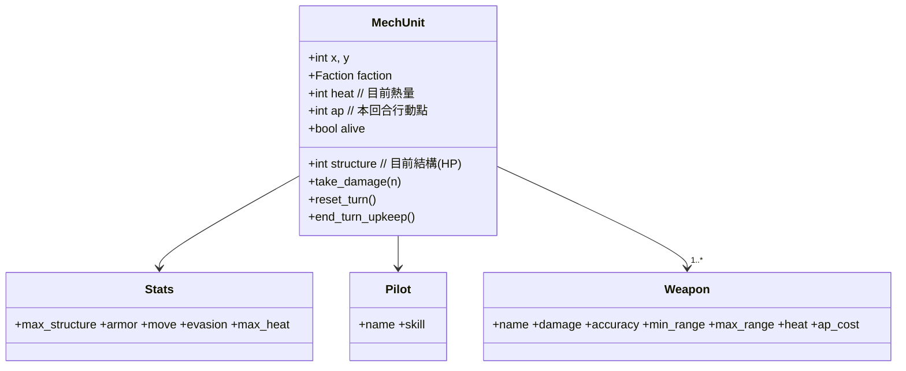

# Part 3 — 機甲單位：資料模型、部署與選取

> 對應原始碼：`components.py`、`entity.py`（部署於 `game_states.py::DeployState`）。
> 前一章：[part2 戰場](part2_battlefield.md)　·　下一章：[part4 回合與 AP](part4_turns_ap.md)

## 本章目標
把「機甲」變成資料：底盤數值、駕駛、武器，放上戰場、畫出來、能被游標選取。

## 1. 三層資料（SPEC §5）

機甲拆成三個純資料元件（`dataclass`），再由 `MechUnit` 組合：



- **Stats（底盤）**：`max_structure`（結構＝HP）、`armor`（減傷）、`move`（每回合移動點）、`evasion`（迴避，扣命中）、`max_heat`（熱量上限）。
- **Pilot（駕駛）**：`skill` 直接加在命中率上。
- **Weapon（武器）**：`damage`、`accuracy`（基礎命中）、`min_range`/`max_range`（射程帶）、`heat`（開火生熱）、`ap_cost`（行動點消耗，預設 1）。

```python
# components.py（節錄）
@dataclass
class Stats:
    max_structure: int
    armor: int
    move: int
    evasion: int
    max_heat: int = 100
```

## 2. MechUnit：把元件組起來

`MechUnit` 繼承 `Entity`（佔格物件：`x/y/char/color/name`），再加上戰鬥狀態與便利方法：

- `alive`：`structure > 0`。
- `take_damage(n)`：扣結構（已結算裝甲/背擊的最終值）。
- `reset_turn()`：回合**開始**重置——補滿 AP、散熱 `HEAT_DISSIPATION`、清 `has_moved`。
- `end_turn_upkeep()`：回合**結束**維護——若過熱則受 `OVERHEAT_DAMAGE`（詳見 [part4](part4_turns_ap.md)、[part7](part7_combat.md)）。
- `heat_penalty`：過熱時回傳 `OVERHEAT_ACC_PENALTY`，否則 0（餵給命中公式）。

> 注意「開始重置」與「結束維護」分屬兩個方法，別混在一起呼叫——`TurnManager` 在階段開始呼叫 `reset_turn()`，階段結束才呼叫 `end_turn_upkeep()`。

## 3. 三款範本機甲

`game_states.py` 提供三個工廠函式（數值自洽於 [part7](part7_combat.md) 的命中/傷害公式）：

| 範本 | 結構 | 裝甲 | 移動 | 迴避 | 武器 | 定位 |
|------|------|------|------|------|------|------|
| 輕型偵察 `s` | 18 | 2 | 6 | 25 | 機槍 D6 R1-4 | 高機動、騷擾、佔點 |
| 中型泛用 `T` | 28 | 5 | 4 | 12 | 自動砲 D12 R1-6 + 近戰拳 D16 R1 | 均衡主力 |
| 重型火力 `H` | 40 | 8 | 3 | 5 | 飛彈艙 D22 R3-9 | 遠程高傷、易過熱 |

```python
def _scout(x, y, faction, name):
    stats = Stats(max_structure=18, armor=2, move=6, evasion=25)
    pilot = Pilot(name=f"{name}駕駛", skill=15)
    weapons = [Weapon("機槍", 6, 70, 1, 4, heat=10)]
    return MechUnit(x, y, name, faction, stats, pilot, weapons, char="s")
```

## 4. 部署

`DeployState.on_enter()` 拿 `procgen.generate_battlefield()` 回傳的兩串部署點，依範本生出雙方各 3 台：

```python
bf, player_pts, enemy_pts = generate_battlefield(deploy_count=3)
for i, (x, y) in enumerate(player_pts):
    units.append(_ROSTER[i % len(_ROSTER)](x, y, Faction.PLAYER, f"我方-{i+1}"))
```

## 5. 繪製與選取

- 繪製：`engine._render_units()` 只畫**可見格**內的單位（迷霧中的敵人不顯示，見 [part6](part6_fov_cover.md)），被選取者加亮底色。
- 游標：`ui.Cursor` 以 `(x, y)` 表示、移動自動 clamp 在地圖內。
- 選取：玩家回合按 `Enter`，`PlayerTurnState._confirm()` 用 `engine.unit_at(cx, cy)` 取游標下的我方單位設為 `selected_unit`。

## 本章完成後你應該能…
- 解釋 Stats/Pilot/Weapon 各欄位影響哪個系統。
- 在戰場上部署雙方機甲並畫出來。
- 用游標選取我方單位，HUD 顯示其結構/AP/熱量/武器。

下一章 → [part4 回合與 AP](part4_turns_ap.md)
