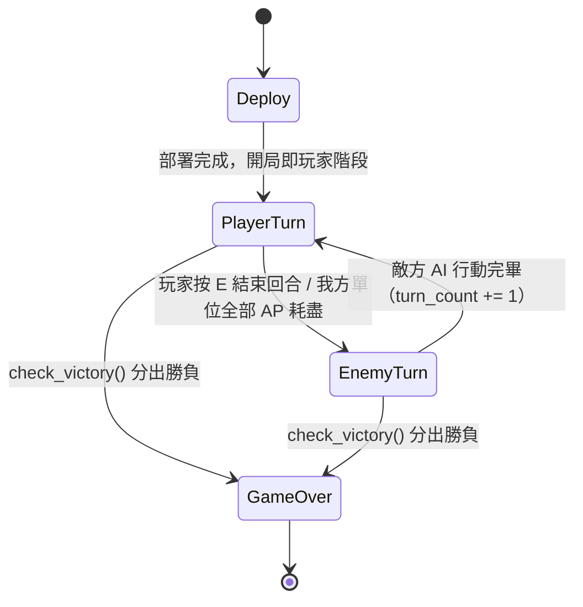
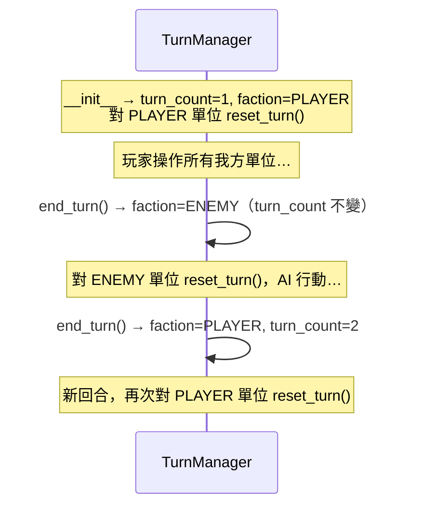
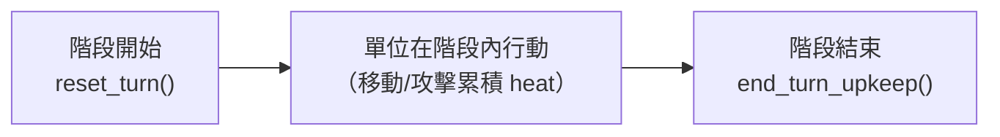

# Part 4 — 回合制與行動點（玩家／敵方階段 + 每單位 AP）

> 對應原始碼：`src/mecha_srpg/turn_manager.py`、`src/mecha_srpg/entity.py`（`MechUnit.reset_turn` / `end_turn_upkeep`）、`src/mecha_srpg/config.py`（`AP_PER_TURN` 等常數）。本章所有數值與規則以 `SPEC.md` §5 / §7 / §9 為唯一真實來源。

前三章我們已經有了：能開窗跑主迴圈（part1）、有地形網格的戰場（part2）、會繪製與選取的機甲單位（part3）。但目前單位還沒有「回合」的概念——任何單位隨時都能動。本章補上 SRPG 的骨架：**回合制流程**與**行動點（AP）**。

---

## 4.1 SRPG 回合模型該怎麼選？

戰棋／戰旗類遊戲的回合推進主要有兩種主流模型：

| 模型 | 代表作 | 推進方式 | 特性 |
|------|--------|----------|------|
| **玩家階段／敵方階段** | Fire Emblem、Into the Breach、Advance Wars | 同陣營所有單位先全部行動完，再換另一陣營 | 結構單純、玩家可通盤調度全隊、AI 階段集中處理 |
| **主動值排序（CTB/ATB）** | 最終幻想戰略版、部分 roguelike | 依速度／主動值把所有單位排進一條時間軸，逐個輪到誰就動誰 | 速度成為核心數值、出手交錯、排程較複雜 |

我們在 `analysis/` 的回合制對比報告中已經比較過兩者。**本專案採「玩家階段／敵方階段」**，理由：

- SRPG 手感（Front Mission／Into the Breach 風格）以「整隊調度」為樂趣核心，玩家階段一次掌控全部我方單位最直覺。
- 敵方 AI（part8）在「敵方階段」內集中跑完，不必和玩家出手交錯，AI 邏輯與狀態機都更乾淨。
- 配合**每單位 AP**（`AP_PER_TURN = 2`），單位在自己的階段內可「移動 + 攻擊」或「移動 + 移動」，保留了戰術深度，不需要主動值排序的複雜度。

> 主動值排序不是不好，只是和我們要的手感與 AI 架構不搭。它會是日後的擴充點，但**不在本專案範圍**。

### 回合與階段的狀態流轉

一場戰鬥從部署開始，在玩家階段與敵方階段之間來回，直到分出勝負：



- `Deploy → PlayerTurn`：依慣例**開局即玩家階段**（`TurnManager.__init__` 直接把 `current_faction` 設為 `PLAYER`）。
- `PlayerTurn ↔ EnemyTurn`：兩個階段交替，由 `end_turn()` 切換。
- `→ GameOver`：任一階段結束後檢查勝負（`check_victory()` 回傳非 `None`）即進入結束狀態。

這張狀態圖對應的「狀態機類別」（`DeployState` / `PlayerTurnState` / `EnemyTurnState` / `GameOverState`）會在 part10 與 `game_states.py` 完整實作。本章先把**驅動這張圖的核心引擎**——`TurnManager`——做好。

---

## 4.2 一個完整「回合」的定義

請先把名詞講清楚，後面才不會亂：

- **階段（phase）**：一個陣營的行動段落。玩家階段、敵方階段各是一個 phase。
- **完整回合（turn）**：玩家階段 + 敵方階段合起來算「一個完整回合」，`turn_count` 從 1 起算。
- **行動點（AP）**：每個單位**在自己陣營的階段開始時**補滿 `AP_PER_TURN = 2`，在階段內消耗。

切換規則（鐵則，見 `turn_manager.py::end_turn`）：

| 切換 | turn_count 變化 | 語意 |
|------|-----------------|------|
| `PLAYER → ENEMY` | 不變 | 同一個完整回合的後半段 |
| `ENEMY → PLAYER` | **+1** | 開啟新的完整回合 |



---

## 4.3 TurnManager 設計

`TurnManager` 不直接碰網格，它只操作 `MechUnit` 與 `Faction`，負責四件事：

1. **記住現在輪到誰**（`current_faction`）與**現在是第幾回合**（`turn_count`）。
2. **階段切換**（`end_turn`）。
3. **階段開始時重置單位**（補 AP / 散熱 / 過熱結算 → 委派給 `MechUnit.reset_turn()`）。
4. **勝負判定**（`check_victory`）。

### 初始化與「階段開始」重置

```python
# turn_manager.py
class TurnManager:
    def __init__(self, units: Iterable[MechUnit]) -> None:
        # 保留為 list 參照：陣亡靠 alive 屬性過濾，不從清單移除
        self.units: list[MechUnit] = list(units)
        # 慣例：開局先進行玩家階段
        self.current_faction: Faction = Faction.PLAYER
        # 完整回合計數（玩家+敵方=1 回合），從第 1 回合開始
        self.turn_count: int = 1
        # 為開局的玩家階段做一次單位重置
        self._begin_phase(self.current_faction)

    def _begin_phase(self, faction: Faction) -> None:
        # 對該陣營所有「存活」單位做回合開始重置
        for unit in self.units_of(faction):
            unit.reset_turn()
```

注意這裡的設計取捨：

- **`units` 用 list 參照保留全部單位（含陣亡）**，查詢時靠 `alive` 屬性過濾，不在戰鬥中把單位從清單刪除。這樣 `check_victory()` 仍能看到「某陣營全滅」這件事，外部也不必小心翼翼地維護清單一致性。
- **重置只對「即將行動」的陣營做**。玩家階段開始時只重置玩家單位；敵方單位的 AP 要等到敵方階段開始才補。這保證「同一回合內」單位的資源狀態是對的。

### 查詢介面

```python
def units_of(self, faction: Faction) -> list[MechUnit]:
    # 指定陣營「目前存活」的單位
    return [u for u in self.units if u.faction == faction and u.alive]

def active_units(self) -> list[MechUnit]:
    # 當前行動陣營的存活單位
    return self.units_of(self.current_faction)

def has_actionable_units(self) -> bool:
    # 當前陣營是否還有 AP > 0 的存活單位
    return any(u.ap > 0 for u in self.active_units())
```

`has_actionable_units()` 是給狀態機用的：當它回傳 `False`，代表本階段所有單位都動完了，`PlayerTurnState` 可以提示「按 E 結束回合」，`EnemyTurnState` 則可以自動 `end_turn()`。

### 階段切換

```python
def end_turn(self) -> Faction:
    if self.current_faction == Faction.PLAYER:
        self.current_faction = Faction.ENEMY        # 同一完整回合的後半段
    else:
        self.current_faction = Faction.PLAYER
        self.turn_count += 1                        # 開啟新的完整回合
    self._begin_phase(self.current_faction)         # 對新陣營重置
    return self.current_faction
```

`end_turn()` 把「切換陣營」「視情況累加回合數」「重置新陣營單位」三件事綁在一起，外部只要呼叫它，就能保證新階段一開始單位狀態都正確。

---

## 4.4 AP 消耗規則

AP（行動點）是單位在自己階段內的「行動預算」。`AP_PER_TURN = 2`（`config.py`，SPEC §7）。消耗規則：

| 行動 | AP 消耗 | 說明 |
|------|---------|------|
| 移動 | **1** | 移動一次（沿路徑走到可達格）扣 1 AP，與走幾步無關 |
| 攻擊 | **`weapon.ap_cost`**（預設 1） | 由武器決定，重武器可設更高 |
| Wait | 結束該單位 | 不靠扣 AP，直接把單位本回合行動結束 |

因為 `AP_PER_TURN = 2`，一個單位在自己階段內典型可以：

- **移動 + 攻擊**（最常見：走到射程內開火，1 + 1 = 2 AP）
- **移動 + 移動**（純走位拉開距離 / 趨近）
- **攻擊 + 攻擊**（原地對同一目標連續開兩槍，若雙方都在射程內）

AP 的扣除由 `MechUnit` 自己管理（`entity.py`）：

```python
# entity.py
def can_act(self) -> bool:
    # 仍可行動：存活且尚有 AP
    return self.alive and self.ap > 0

def spend_ap(self, amount: int = 1) -> bool:
    # 嘗試消耗 AP；不足回傳 False（行動應被拒絕）
    if self.ap < amount:
        return False
    self.ap -= amount
    return True
```

實際的行動類別（`MoveAction` / `AttackAction` / `WaitAction`，見 `actions.py` 與 part5、part7）在執行前會先用 `spend_ap()` 檢查並扣點：

- `MoveAction` 執行前 `unit.spend_ap(1)`。
- `AttackAction` 執行前 `unit.spend_ap(weapon.ap_cost)`。
- `WaitAction` 不扣 AP，而是直接把 `unit.ap` 歸 0（或設旗標），讓 `has_actionable_units()` 不再把它算進去——效果就是「這單位這回合不動了」。

> **設計重點**：`TurnManager` 負責「補 AP」（階段開始），`MechUnit.spend_ap` 負責「花 AP」，`Action` 負責「決定花多少」。三者職責分離，這也是為什麼 `TurnManager` 完全不需要知道有「移動」或「攻擊」這些事。

---

## 4.5 過熱與散熱：在回合的哪裡結算？

熱量是本專案的核心資源張力（SPEC §7）。相關常數（`config.py`）：

```python
HEAT_DISSIPATION   = 20   # 每回合自然散熱
OVERHEAT_ACC_PENALTY = 25 # 過熱時命中 -25
OVERHEAT_DAMAGE    = 5    # 過熱時「回合結束」受到的結構傷害
# Stats.max_heat 預設 100；heat >= max_heat 即過熱
```

關鍵問題是**散熱與過熱傷害分別在回合的哪一刻發生**。我們刻意把它們拆成「回合開始」與「回合結束」兩個時機，由 `MechUnit` 的兩個方法分別負責：



### 回合開始：`reset_turn()` — 補 AP + 散熱

```python
# entity.py
def reset_turn(self) -> None:
    # 補滿 AP、清除已移動旗標、自然散熱
    self.ap = AP_PER_TURN
    self.has_moved = False
    self.heat = max(0, self.heat - HEAT_DISSIPATION)
```

由 `TurnManager._begin_phase()` 在該陣營階段開始時對每個存活單位呼叫。散熱放在這裡，意味著「上一回合累積的熱量，到了下一個自己的階段才散掉」。

### 回合結束：`end_turn_upkeep()` — 過熱傷害

```python
# entity.py
def end_turn_upkeep(self) -> int:
    # 若仍過熱，回合結束受 OVERHEAT_DAMAGE 結構傷害；回傳實際扣血量
    if self.is_overheated:
        return self.take_damage(OVERHEAT_DAMAGE)
    return 0

@property
def is_overheated(self) -> bool:
    return self.heat >= self.stats.max_heat

@property
def heat_penalty(self) -> int:
    # 過熱時命中懲罰，供 combat.hit_chance 取用
    return OVERHEAT_ACC_PENALTY if self.is_overheated else 0
```

為什麼要拆成兩個時機？因為它造就了一條清楚的**過熱懲罰因果鏈**：

1. 玩家在自己的階段大量開火 → `heat` 飆到 `>= max_heat`，本階段內後續攻擊立即吃到 `heat_penalty`（命中 −25，由 `combat.py` 在計算命中率時讀 `unit.heat_penalty`）。
2. 階段結束的 upkeep → 若還過熱，再吃 `OVERHEAT_DAMAGE = 5` 結構傷害（自損）。
3. 下次輪到自己 → `reset_turn()` 散熱 `−20`，可能脫離過熱。

> **誰呼叫 `end_turn_upkeep()`？** 由狀態機在某陣營階段「結束時」對該陣營每個存活單位呼叫（`PlayerTurnState` / `EnemyTurnState` 收尾處，見 part10）。`TurnManager` 本身只負責回合開始的 `reset_turn()`；過熱傷害屬「回合結束效果」，與「回合開始重置」刻意分開，避免散熱與扣血混在同一個方法裡造成順序錯亂。

---

## 4.6 勝負判定

```python
# turn_manager.py
def check_victory(self) -> Optional[Faction]:
    player_alive = any(u.faction == Faction.PLAYER and u.alive for u in self.units)
    enemy_alive  = any(u.faction == Faction.ENEMY  and u.alive for u in self.units)
    if not enemy_alive:
        return Faction.PLAYER   # 敵方全滅 → 玩家勝
    if not player_alive:
        return Faction.ENEMY    # 我方全滅 → 敵方勝
    return None                 # 尚未分出勝負
```

回傳值語意（SPEC §9）：

- `Faction.PLAYER`：玩家獲勝（敵方無存活單位）。
- `Faction.ENEMY`：敵方獲勝（玩家無存活單位）。
- `None`：尚未分出勝負。

狀態機在每個階段結束後（以及每次造成傷害後也可以提前檢查）呼叫一次，非 `None` 就轉入 `GameOverState`。注意：若雙方同時全滅，依實作順序**優先回傳 `PLAYER`**（先檢查敵方全滅）。

---

## 4.7 把它串起來：一個最小回合循環

下面是把本章元件接起來的概念性片段（不含繪製與輸入，那是 part10 的事），用來說明 `TurnManager` 在主流程中的位置：

```python
tm = TurnManager(all_units)   # 開局即玩家階段，已對玩家單位 reset_turn()

# === 玩家階段 ===
# （狀態機在此處理玩家輸入：選單位 → MoveAction / AttackAction / WaitAction，
#   每個 Action 內部呼叫 unit.spend_ap(...)）
while tm.has_actionable_units():
    ...  # 玩家操作，或玩家直接按 E
# 玩家結束前，對我方單位做回合結束 upkeep（過熱傷害）
for u in tm.units_of(Faction.PLAYER):
    u.end_turn_upkeep()

if tm.check_victory() is not None:
    ...  # 進入 GameOverState

tm.end_turn()   # → 敵方階段，對敵方單位 reset_turn()

# === 敵方階段 ===
# （HostileAI 依序操作每個敵方單位，見 part8）
...
for u in tm.units_of(Faction.ENEMY):
    u.end_turn_upkeep()
tm.end_turn()   # → 回玩家階段，turn_count += 1
```

可以看到 `TurnManager` 只暴露幾個小而清楚的方法（`has_actionable_units` / `units_of` / `end_turn` / `check_victory`），把「何時補 AP、何時散熱、何時扣過熱傷害」這些時序問題收斂成一致的規則，狀態機只需照流程呼叫即可。

---

## 本章完成後你應該能…

- 說明「玩家／敵方階段」與「主動值排序」兩種 SRPG 回合模型的差異，並理解本專案為何選前者。
- 畫出（並讀懂）`Deploy → PlayerTurn ↔ EnemyTurn → GameOver` 的狀態流轉，以及 `turn_count` 在哪一步遞增。
- 實作／解釋 `TurnManager` 的 `end_turn` / `_begin_phase` / `units_of` / `has_actionable_units` / `check_victory`。
- 說清楚 AP 消耗規則（移動 1、攻擊 `weapon.ap_cost`、Wait 結束單位）以及 `spend_ap` 與「補 AP」的職責分工。
- 解釋過熱／散熱為何拆成「回合開始 `reset_turn`（散熱 +補 AP）」與「回合結束 `end_turn_upkeep`（過熱傷害）」兩個時機，以及過熱命中懲罰（`heat_penalty`）如何在同一階段內立即生效。

## 下一章

[part5_movement.md](part5_movement.md) — **移動範圍與尋路**：用 `tcod.path.dijkstra2d` 算距離場求出 `reachable_tiles`（可達格），用 `tcod.path.hillclimb2d` 取實際 `path_to`（路徑），並把「移動消耗 1 AP」這條規則接到移動範圍高亮與逐格移動動畫上。
