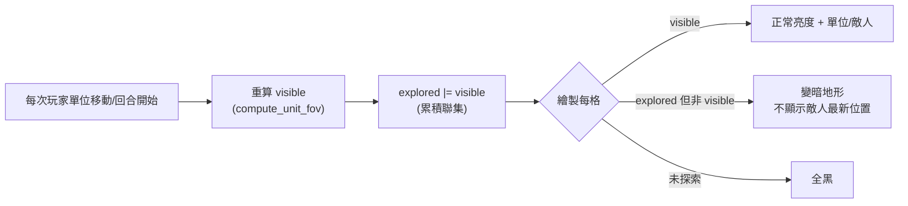
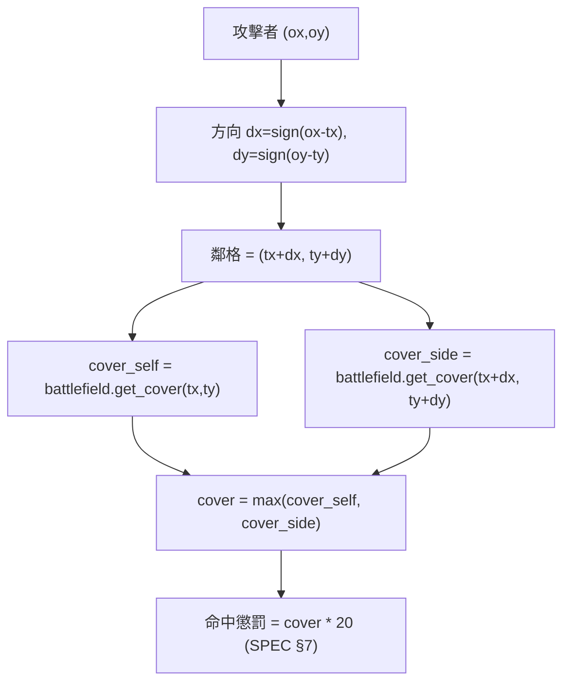

# part6 — 視野 FOV、射線 line of fire、掩體 cover

> 對應原始碼：`src/mecha_srpg/fov.py`（本章新建）、`src/mecha_srpg/battlefield.py`、`src/mecha_srpg/config.py`。
> 數值與簽名以 `SPEC.md` 為唯一真實來源：座標慣例 §2、地形 §6、命中懲罰 §7（`cover * 20`）、`mtcore.batch_line_of_fire` §4。

本章目標：讓每個機甲「只看得到看得到的東西」（迷霧戰爭），並在開火前判斷「打不打得到」（射線）與「目標躲得多好」（掩體）。三者看似都跟「視線」有關，但語意不同：

| 概念 | 問的問題 | 用什麼判斷 | 影響 |
|------|----------|------------|------|
| FOV（視野） | 我**看得到**哪些格？ | 地形 `transparent`（透光） | 迷霧戰爭、能否選為目標 |
| line of fire（射線） | 子彈**飛得過去**嗎？ | 兩格之間是否被不透光物擋住 | 能不能開火（part7 射程＋射線雙條件） |
| cover（掩體） | 目標**躲在後面**嗎？ | 目標格與其朝攻方那側鄰格的 `cover` 等級 | 命中率 `-cover*20`（SPEC §7） |

注意一個關鍵區別：**透明（transparent）不等於可射擊**。森林 `transparent=False` 會擋視野，但瓦礫 `transparent=True` 看得穿、子彈也飛得過，卻提供 `cover=1`。所以「看得到」「打得到」「打得準」是三條獨立的判斷線。

---

## 1. tcod 的 FOV：`tcod.map.compute_fov`

`tcod` 提供現成的視野計算，輸入一張「透明度陣列」與觀察者位置，輸出「可見格」的布林遮罩。我們在 part2 的 `battlefield.py` 已經備好 `transparent_array()`（`[y, x]` 布林陣列），直接餵進去即可。

### 1.1 演算法選擇：SYMMETRIC_SHADOWCAST

`tcod.map.compute_fov` 的 `algorithm` 參數可選多種演算法。本專案固定用 **`tcod.constants.FOV_SYMMETRIC_SHADOWCAST`**，理由：

- **對稱性**：A 看得到 B ⟺ B 看得到 A。戰棋中這點很重要——如果你能看到敵人卻不能被它看到（或反之），玩家會覺得規則不公平、AI 行為也難以推理。
- 視覺結果自然、無明顯瑕疵，是 roguelike 的常用預設。

### 1.2 座標慣例的吸收（SPEC §2 鐵則）

這是最容易踩雷的地方。SPEC §2 規定：

- 邏輯座標一律 `(x, y)`；
- numpy 陣列一律 `[y, x]`（row-major），與 tcod 一致；
- `tcod.map.compute_fov` 的 **pov（觀察點）參數是 `(y, x)` 順序**（即 row-major 的 `(i, j)`），這跟我們對外用的 `(x, y)` 相反。

因此「翻轉」這件事必須**集中吸收在 fov.py 一個地方**，其他模組永遠只用 `(x, y)`：

```python
# fov.py
"""fov.py — 視野 FOV、射線 line of fire、掩體 cover（SPEC §2/§6/§7）。

用途：
    - compute_unit_fov：用 tcod.map.compute_fov 算出單位的可見格遮罩。
    - line_of_fire：Bresenham 射線，判斷 (ox,oy)→(tx,ty) 子彈能否飛抵（可射擊）。
    - cover_against：依攻擊方向取得目標所獲得的掩體等級（SPEC §7：cover*20）。
    - batch_line_of_fire：批次射線，對齊 mtcore §4 簽名，供 AI 一次評估多目標。

對應教學 part：part6_fov_cover（本章）、part7_combat（射程＋射線＋掩體入命中）、
    part8_ai（batch_line_of_fire 熱點）、part9_cpp_core（射線批次下沉 C++）。

座標慣例（SPEC §2 鐵則）：
    - 對外一律 (x, y)；numpy 與 tcod 內部為 [y, x] / (y, x)，差異全部吸收在本檔。
"""

from __future__ import annotations

from typing import List, Tuple

import numpy as np
import tcod.map        # tcod.map.compute_fov
import tcod.constants  # FOV_SYMMETRIC_SHADOWCAST

from .battlefield import Battlefield

Coord = Tuple[int, int]


def compute_unit_fov(
    battlefield: Battlefield,
    ox: int,
    oy: int,
    radius: int = 0,
) -> np.ndarray:
    """計算觀察者 (ox, oy) 的可見格遮罩（[y, x] 布林）。

    Args:
        battlefield: 戰場（提供 transparent_array）。
        ox, oy: 觀察者邏輯座標 (x, y)。
        radius: 視野半徑；0 表示不限制（看到地圖邊界）。
    Returns:
        np.ndarray[bool, (H, W)]：True 表該格可見。
    """
    transparent = battlefield.transparent_array()  # [y, x] 布林（SPEC §2）
    # tcod.map.compute_fov 的 pov 參數是 (y, x) 順序 → 在這裡吸收翻轉！
    visible = tcod.map.compute_fov(
        transparent,
        pov=(oy, ox),                                  # 注意：(y, x)
        radius=radius,
        light_walls=True,                              # 牆面被照亮（看得到牆本身）
        algorithm=tcod.constants.FOV_SYMMETRIC_SHADOWCAST,
    )
    return visible  # [y, x] 布林，呼叫端用 visible[y, x] 查詢


def is_visible(visible: np.ndarray, x: int, y: int) -> bool:
    """查詢 (x, y) 是否在可見遮罩內（吸收 [y, x] 索引）。"""
    h, w = visible.shape
    if 0 <= x < w and 0 <= y < h:
        return bool(visible[y, x])
    return False
```

要點：

- `transparent_array()` 已是 `[y, x]`，直接交給 tcod，**不要轉置**。
- 唯一要翻轉的是 **scalar 的觀察點**：`pov=(oy, ox)`。把它寫在 `compute_unit_fov` 一處，外界只丟 `(x, y)`。
- `light_walls=True`：不透光的牆面本身會被標記為可見（否則你會「看到牆後的黑」卻看不到牆，視覺很怪）。

---

## 2. 迷霧戰爭：visible 與 explored 的累積

戰旗的迷霧戰爭通常分兩層：

- **visible（當前可見）**：本回合站在此處看得到的格，正常亮度繪製。
- **explored（曾經探索）**：歷史上看過的格，即使現在看不見也記得地形，但**變暗**繪製。



實作上 `explored` 是一張持久的 `[y, x]` 布林陣列，活在 `Battlefield` 或 `Engine`；每次重算 `visible` 後用聯集累積：

```python
# 概念示意（實際持有位置見 part10 的 engine/battlefield 整合）
explored = np.zeros((bf.height, bf.width), dtype=bool)   # 持久，初始全未探索

def update_player_fov(bf, player_units, explored):
    """以所有我方單位的 FOV 聯集，更新 visible 並累積 explored。"""
    visible = np.zeros((bf.height, bf.width), dtype=bool)
    for u in player_units:
        if u.alive:
            visible |= compute_unit_fov(bf, u.x, u.y)   # 多單位視野取聯集
    explored |= visible                                  # 看過就記得
    return visible
```

渲染時（part10 的 `ui.py` / `engine.py`）依三態決定背景色明度：visible → 原色、explored-only → 乘上一個調暗係數、未探索 → 黑。**注意：explored-only 的格不該顯示敵人「現在」的位置**——你只記得地形，不記得敵人跑哪去了，這正是迷霧戰爭的張力來源。

---

## 3. 射線 line of fire：Bresenham 與 FOV 的差異

開火能不能打中，第一關不是命中率，而是**子彈飛得過去嗎**。這用一條從攻擊者到目標的離散直線（Bresenham 線）來判斷：沿線逐格檢查，如果中途遇到不透光（擋彈）的格，就「被擋住」。

### 3.1 為什麼不直接用 FOV？

FOV 是「以觀察者為中心的扇形批次計算」，而射線是「兩點之間的單條線」。兩者結果**通常一致但不保證相同**（shadowcasting 的可見性與單條 Bresenham 線可能在邊角格差一格）。戰鬥判定要的是**明確、可解釋的單線**——玩家看著那條紅線就知道「為什麼打不到」，所以我們用獨立的 Bresenham 射線，而非查 FOV 遮罩。

> 透明 vs 可射擊：本專案簡化為「擋視線的東西也擋子彈」，即都看 `transparent`。森林（`transparent=False`）既擋視野也擋火線；瓦礫（`transparent=True`）看得穿也打得穿但給掩體。若日後要區分「煙霧擋視線不擋彈」之類，可在 `Tile` 加一個 `blocks_fire` 欄位，這裡改判該欄位即可。

### 3.2 用 `tcod.los` 或自寫 Bresenham

`tcod` 在 `tcod.los`（`tcod.los.bresenham`）提供 Bresenham 取線工具，回傳沿線的整數座標序列。我們沿線檢查透明度，**到達目標前**若有任一中間格不透明即視為被擋；起點與終點本身不算遮蔽（你不會被自己或目標擋住）。

```python
# fov.py（續）
def line_of_fire(
    battlefield: Battlefield,
    ox: int,
    oy: int,
    tx: int,
    ty: int,
) -> bool:
    """攻擊者 (ox,oy) 對目標 (tx,ty) 是否有可開火的射線。

    沿 Bresenham 線逐格檢查「中間格」是否透光（可穿透）：
    任一中間格不透光 → 被擋住，回傳 False。起點與終點不計入遮蔽。

    與 FOV 的差異：本函式是「單條可解釋的火線」，供命中判定與 UI 紅線使用，
    不查 compute_unit_fov 的扇形遮罩（SPEC §2 用 (x,y) 介面）。
    """
    line = _bresenham(ox, oy, tx, ty)   # 含起點與終點的 (x, y) 序列
    # 去掉頭尾，只檢查中間格是否擋彈
    for (cx, cy) in line[1:-1]:
        if not battlefield.is_transparent(cx, cy):
            return False
    return True


def _bresenham(x0: int, y0: int, x1: int, y1: int) -> List[Coord]:
    """整數 Bresenham 直線，回傳含端點的 (x, y) 序列。

    優先用 tcod.los.bresenham（回傳 [N,2] 的 (x, y)）；若該版本 tcod 無此 API，
    退回本檔自寫版本，行為一致（皆含起點與終點）。
    """
    try:
        import tcod.los  # tcod.los.bresenham
        # tcod.los.bresenham 回傳 numpy [N, 2]，每列為 (x, y)
        pts = tcod.los.bresenham((x0, y0), (x1, y1)).tolist()
        return [(int(px), int(py)) for px, py in pts]
    except Exception:
        return _bresenham_py(x0, y0, x1, y1)


def _bresenham_py(x0: int, y0: int, x1: int, y1: int) -> List[Coord]:
    """純 Python Bresenham（fallback）。經典整數增量演算法，含端點。"""
    points: List[Coord] = []
    dx = abs(x1 - x0)
    dy = -abs(y1 - y0)
    sx = 1 if x0 < x1 else -1
    sy = 1 if y0 < y1 else -1
    err = dx + dy
    cx, cy = x0, y0
    while True:
        points.append((cx, cy))
        if cx == x1 and cy == y1:
            break
        e2 = 2 * err
        if e2 >= dy:
            err += dy
            cx += sx
        if e2 <= dx:
            err += dx
            cy += sy
    return points
```

### 3.3 批次射線：對齊 `mtcore.batch_line_of_fire`（SPEC §4）

AI（part8）在列舉「移動到某格後能打到哪些目標」時，會對**很多目標**做射線查詢，這是熱點。SPEC §4 定義了批次簽名，並要求 **Python 端有 fallback**（沒編 C++ 也能跑）：

```python
# fov.py（續）— 簽名嚴格對齊 SPEC §4 的 mtcore.batch_line_of_fire
def batch_line_of_fire(
    transparent: np.ndarray,        # [y, x] 布林（即 battlefield.transparent_array()）
    ox: int,
    oy: int,
    targets: List[Coord],           # 一串 (x, y) 目標
) -> List[bool]:
    """批次射線查詢：從 (ox,oy) 對每個 target 是否有火線。回傳等長 bool 清單。

    對齊 SPEC §4 的 mtcore.batch_line_of_fire(transparent, ox, oy, targets)。
    part9 會把此函式下沉 C++ 加速；此處為純 Python fallback，公式（同 line_of_fire）
    必須與 C++ 完全一致。
    """
    h, w = transparent.shape
    results: List[bool] = []
    for (tx, ty) in targets:
        line = _bresenham(ox, oy, tx, ty)
        blocked = False
        for (cx, cy) in line[1:-1]:           # 只看中間格
            if 0 <= cx < w and 0 <= cy < h and not transparent[cy, cx]:
                blocked = True
                break
        results.append(not blocked)
    return results
```

> 漸進原則（SPEC §4/§60 行原則）：`ai.py` 應 `try: import mtcore` 成功時呼叫 `mtcore.batch_line_of_fire(...)`，失敗時改呼叫本檔 `fov.batch_line_of_fire(...)`。兩者輸入輸出與遮蔽規則必須逐格一致，否則「有沒有編 C++」會改變遊戲行為。

---

## 4. 掩體 cover：依攻擊方向決定

掩體是戰旗的靈魂機制：同一格目標，從不同方向打，掩體效果不同。SPEC §7 規定命中懲罰為 `cover * 20`（每級 -20%），而掩體等級怎麼取，是本節重點。

### 4.1 規則：目標格與「朝攻方那側的鄰格」取較大者

直覺：目標躲在掩體後方，能擋住攻擊的是「目標與攻擊者之間」那塊地形。本專案採常見的戰棋規則：

> 取兩個候選的 cover，取**較大值**作為實際掩體等級：
> 1. **目標自身所在格**的 `cover`（例如站在瓦礫/森林裡本身有掩護）。
> 2. **目標朝向攻擊者那一側的鄰格**的 `cover`（例如目標貼著一面牆/建物，攻擊從牆的方向來）。

「朝攻方那側的鄰格」＝沿「目標→攻擊者」方向，從目標格踏出一步的那格。方向用 `sign(攻方 - 目標)` 取 -1/0/+1。



### 4.2 為什麼是「朝攻方那側」而非「背對攻方那側」？

掩體要擋在**目標與攻擊者之間**才有用。沿「目標 → 攻擊者」方向踏出一步，正好落在「面向攻方」的那格——那塊地形就是擋在火線上的掩體。若攻擊從另一側來，這格就換成另一側的鄰格，於是「繞背攻擊」可以繞過掩體，逼出走位戰術。

### 4.3 實作

```python
# fov.py（續）
def _sign(v: int) -> int:
    """符號函式：負→-1、零→0、正→+1。"""
    return (v > 0) - (v < 0)


def cover_against(
    battlefield: Battlefield,
    tx: int,
    ty: int,
    ox: int,
    oy: int,
) -> int:
    """目標 (tx,ty) 對來自 (ox,oy) 的攻擊所獲得的掩體等級（0/1/2）。

    規則（SPEC §7，掩體入命中為 cover*20）：取「目標自身格」與「目標朝攻方
    那側鄰格」兩者 cover 的較大值。攻方鄰格＝沿 目標→攻方 方向踏一步。

    被 combat.resolve_attack 呼叫：
        cover = fov.cover_against(bf, target.x, target.y, attacker.x, attacker.y)
    """
    cover_self = battlefield.get_cover(tx, ty)          # 界外回傳 0（battlefield 已處理）
    dx = _sign(ox - tx)
    dy = _sign(oy - ty)
    cover_side = battlefield.get_cover(tx + dx, ty + dy)
    return max(cover_self, cover_side)
```

### 4.4 掩體對命中的影響（接 part7）

掩體最終以 `cover_pen = cover * COVER_PENALTY_PER_LEVEL`（`COVER_PENALTY_PER_LEVEL = 20`，見 `config.py`）扣命中。各地形的 cover 等級（SPEC §6）：

| 地形 | cover | 命中懲罰 |
|------|-------|----------|
| PLAIN 平地 | 0 | 0 |
| FOREST 樹林 | 1 | -20% |
| RUBBLE 瓦礫 | 1 | -20% |
| BUILDING 建物 | 2 | -40% |
| WATER 水域 | 0 | 0 |
| HILL 高地 | 1 | -20% |

範例：目標站平地（cover 0），但其面向攻方的鄰格是建物（cover 2），則 `cover_against = max(0, 2) = 2`，命中 -40%。這就是「貼牆站」的戰術價值。完整命中公式拆解見 part7。

---

## 本章完成後你應該能…

- 用 `tcod.map.compute_fov`（`FOV_SYMMETRIC_SHADOWCAST`）算出單位可見格，並理解 **pov 參數是 `(y, x)`、要在 fov.py 一處吸收翻轉**（SPEC §2）。
- 實作 visible/explored 雙層迷霧戰爭，渲染時把 explored-only 的格變暗、不洩漏敵人最新位置。
- 用 Bresenham（`tcod.los` 或自寫 fallback）寫出 `line_of_fire`，並說清楚它與 FOV 的差異（單條可解釋火線 vs 扇形可見性；透明 vs 可射擊）。
- 實作對齊 SPEC §4 的 `batch_line_of_fire` 純 Python fallback，供 AI 批次查詢。
- 寫出 `cover_against`：依攻擊方向取「目標格」與「朝攻方鄰格」的較大 cover，理解它如何以 `cover*20` 影響命中（SPEC §7）。

## 下一章

**part7 — 戰鬥結算**：把距離、掩體、射程／射線、迴避、過熱湊成完整的命中公式（逐項拆解＋數值範例），結算傷害（裝甲、背擊 `REAR_MULT`、命中骰），導入熱量系統（開火加熱、過熱懲罰與結構傷害、回合散熱），並串起 `AttackAction` → `resolve_attack` → 訊息日誌。這些數學是熱點，part9 會原封不動下沉到 C++ `mtcore`，所以純 Python 版與 C++ 版**公式必須一致**。
