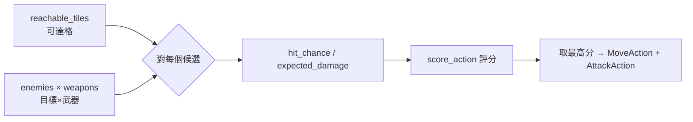
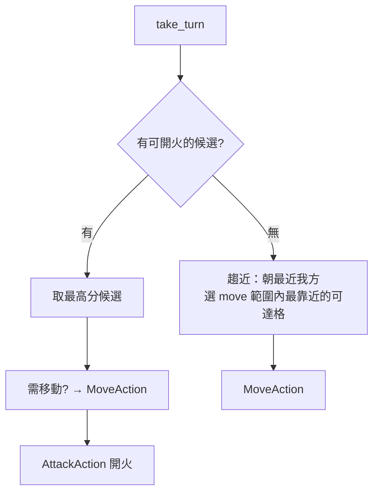

# Part 8 — 敵方戰術 AI（候選評分）

> 對應原始碼：`ai.py::HostileAI`（執行於 `game_states.py::EnemyTurnState`）。
> 前一章：[part7 戰鬥結算](part7_combat.md)　·　下一章：[part9 C++ 核心](part9_cpp_core.md)

## 本章目標
讓敵方機甲「自己會打」：列舉所有可能行動、評分、挑最好的做。這套「列舉→評分→取最大」是戰棋 AI 最實用的骨架。

## 1. 候選空間

對一個敵方單位，候選 =
```
可達格（movement.reachable_tiles） × 可攻擊的我方目標 × 武器
```
每個候選代表「移到某格、用某武器打某目標」。單回合每單位可能數百~數千個候選——這就是為何它是 [part9](part9_cpp_core.md) 要下沉 C++ 的熱點。



## 2. 評分函式（SPEC §4 `score_action`）

純 Python 與 C++ 同邏輯。傾向（越高越好）：

| 因子 | 權重 | 用意 |
|------|------|------|
| 期望傷害 `expected_dmg` | ×10（主項） | 打得越痛越好 |
| 可一擊擊殺 | +50 | 優先收殘血 |
| 命中率 `hit` | ×5 | 偏好穩定攻擊 |
| 攻擊後自身掩體 `cover_after` | ×8（低血再加成） | 打完躲好、自保 |
| 與最近敵距離 `dist_after` | −1（懲罰距離） | 趨近、保持壓力 |

```python
def _py_score_action(my_hp, target_hp, expected_dmg, hit, dist_after, cover_after, in_range):
    score = 0.0
    if in_range:
        score += expected_dmg * 10.0
        if expected_dmg >= target_hp:
            score += 50.0          # 擊殺獎勵
        score += hit * 5.0
    score += cover_after * 8.0
    score -= dist_after * 1.0
    return score
```

> 調 AI 個性＝調權重：把 `cover_after` 加大＝謹慎龜縮型；把擊殺獎勵加大＝嗜血突進型。

## 3. 決策流程：`take_turn(engine, unit) -> list[Action]`



- **能打**：產生 `[MoveAction?, AttackAction]`，受 AP 限制（移動 1 AP + 攻擊 `ap_cost`）。
- **打不到**：用 `reachable_tiles` 選「離最近我方最近」的可達格趨近，為下回合創造攻擊位。
- **沒 AP / 無路**：`WaitAction`。

回傳的是 **Action 列表**（純規劃，不直接改 engine）；`EnemyTurnState` 再逐一 `perform`。

## 4. 為何適合下沉 C++（接 part9）
候選評分是「巢狀迴圈裡的純算術」：無物件配置、無 I/O，只有 `hit_chance`/`expected_damage`/`score_action`。Python 端負責列舉候選與組裝 Action，**數學批次交給 `mtcore`**——典型的「薄 Python 殼 + 厚 C++ 核」。

## 5. ⚠️ 整合提醒
本起手的 `ai.py` 與 `movement`/`actions` 的部分簽名在並行產出時分歧（見根目錄 `INTEGRATION_NOTES.md`）：
- `reachable_tiles(bf, unit)` 應為 `reachable_tiles(bf, engine.units, unit)`。
- `MoveAction(unit, x, y)` 應改為先 `path_to(...)` 再 `MoveAction(path)`。
- `AttackAction(unit, target, weapon)` 應為 `AttackAction(target, weapon)`、`WaitAction(unit)` → `WaitAction()`。

統一後敵方 AI 即可完全生效；在那之前 `EnemyTurnState` 以 try/except 保護，敵方會安全跳過而非崩潰。

## 本章完成後你應該能…
- 描述「列舉候選→評分→取最大」的 AI 骨架。
- 透過調權重改 AI 個性。
- 指出哪段是效能熱點、為何適合 C++。

下一章 → [part9 C++ 核心](part9_cpp_core.md)
