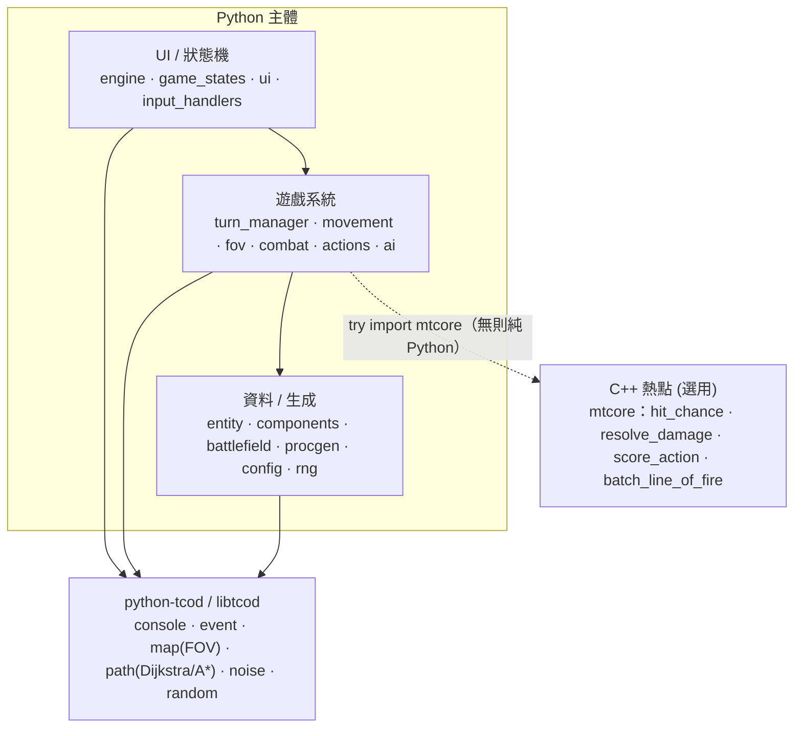

> 封存 2026-10-24，由 wf/workflows/planning/specs/core/README.md 取代（專案重做為網頁版，見 wf/workflows/decisions.md）

# 回合制機甲戰旗（Mecha Tactics）

一個 **Python（主體）+ C++（核心熱點）+ python-tcod（打底）** 的回合制機甲戰術 SRPG 起手專案 + 分段教學。風格近 Front Mission／Into the Breach／BattleTech：格狀戰場、雙方機甲、移動範圍、視野/掩體、命中/傷害/熱量、敵方戰術 AI。

> 設計契約：[`SPEC.md`](SPEC.md)（唯一真實來源）。教學：[`docs/README.md`](docs/README.md)（part0–part10）。
> 跨模組待整合事項：[`INTEGRATION_NOTES.md`](INTEGRATION_NOTES.md)。

## 安裝與執行

### 純 Python 路線（先跑起來，免編譯器）
```bash
pip install tcod numpy
python -m mecha_srpg          # 從 src/ 執行；或先 pip install -e .
```
> C++ 加速為**選用**：未編譯時，戰鬥與 AI 數學自動走純 Python fallback（`combat.py`/`ai.py` 內 `try import mtcore`）。

### C++ 加速路線（選用）
需要 C++17 編譯器（Windows: MSVC Build Tools）。
```bash
pip install -e .             # scikit-build-core + pybind11 會編譯 mtcore
```
編好後 `import mtcore` 生效，命中/傷害/AI 評分/批次視線改由 C++ 計算（行為一致，只變快）。

## 操作（SPEC §8）
| 鍵 | 功能 |
|----|------|
| 方向鍵 / WASD | 移動游標 |
| Enter | 選取 / 確認 |
| M | 移動模式（顯示可達格藍底） |
| F | 攻擊模式（顯示射程紅底 + 命中預估） |
| Space | 待命（結束該單位） |
| Tab | 切換我方單位 |
| E | 結束我方回合 |
| Esc | 取消 / 返回 |

## 架構



## 專案狀態
- 由多代理並行產出的起手骨架：Python 16 模組 + C++ `mtcore` + 11 章教學。
- **已知**：部分跨模組介面在並行產出時分歧，詳列於 [`INTEGRATION_NOTES.md`](INTEGRATION_NOTES.md)；玩家回合可運行（防禦式呼叫），敵方 AI 待依該文件統一介面後完全生效。
- 後續延伸見 [`docs/part10_ui_winloss.md`](docs/part10_ui_winloss.md)。
