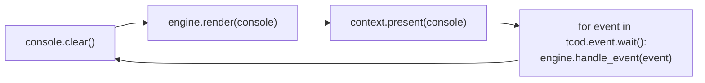
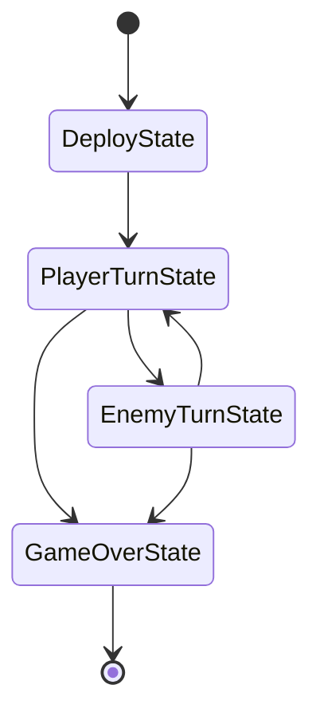

# Part 1 — 開窗與主迴圈

> 上一章（[part0](part0_overview_and_setup.md)）裝好了 `tcod` 與 `numpy`。本章寫出 [`main.py`](../src/mecha_srpg/main.py) 的骨架：載入 tileset、開一個視窗、跑主迴圈、收事件，最後做出一個能顯示 `@` 並用 `Esc` 離開的最小可跑範例。命名、尺寸、鍵位都對齊 [`SPEC §8/§9`](../SPEC.md)。

## 1.1 tileset 載入

tcod 用 **tileset（字型/字元圖集）** 把每個 codepoint 對到一張字元圖。最省事的做法是用 tcod **內建的 CP437 字型**，不需要任何外部檔案：

```python
import tcod

# 內建 CP437（EASCII）字型，16×16 排列，row-major
tileset = tcod.tileset.load_tilesheet(
    tcod.tileset.get_default_charmap_path() if False else
    "dejavu10x10_gs_tc.png",          # tcod 內附的範例字型檔
    32, 8, tcod.tileset.CHARMAP_TCOD,
)
```

更穩、零外部依賴的寫法是直接用 tcod 內建 charmap 產生 tileset：

```python
import tcod

# 直接用內建字型；若不指定 tileset，tcod.context.new(...) 也會給一個預設字型
tileset = tcod.tileset.load_truetype_font(  # 之一：自訂 TTF 路徑
    "your_font.ttf", 16, 16,
) if False else None
```

在本專案 [`main.py`](../src/mecha_srpg/main.py) 我們採最簡路徑：**不手動傳 tileset，讓 `tcod.context.new(...)` 用預設字型**，等需要自訂外觀時再換。

### 中文字型注意事項（可選）

我們的程式碼註解與字串是繁體中文（[`SPEC §10`](../SPEC.md)），但**畫到畫面上的字元**（地形 `.`/`#`/`~`、機甲符號）都是 ASCII/符號，預設字型即可。若你想在 HUD 顯示中文，依本 repo 既有分析（[`analysis/python-tcod/tutorial/cpp_libtcod_cookbook.md §13`](../../../../pas/analysis/python-tcod/tutorial/cpp_libtcod_cookbook.md)）的結論：**需載入含 CJK 字形的 TTF（如 Noto Sans CJK），且 libtcod 把中文當單格寬度 1（已知的單格全形限制）**。本章先用預設字型，中文 HUD 留到 part10 視需要再處理。

## 1.2 建立 context 與 console

`tcod.context.new(...)` 開一個 SDL 視窗並回傳 `Context`；`tcod.console.Console` 是我們每幀畫東西的緩衝區。尺寸用 [`config.py`](../src/mecha_srpg/config.py) 的 `SCREEN_W=80, SCREEN_H=50`（[`SPEC §8`](../SPEC.md)）。

```python
import tcod
from mecha_srpg import config

context = tcod.context.new(
    columns=config.SCREEN_W,        # 80
    rows=config.SCREEN_H,           # 50
    tileset=None,                   # 用預設字型（見 §1.1）
    title="Mecha Tactics",
    vsync=True,
)
# order="F" → console 以 [x, y] 索引；order="C" → [y, x]
console = tcod.console.Console(config.SCREEN_W, config.SCREEN_H, order="F")
```

### console order 慣例

`Console` 的 `order` 決定索引軸順序，這會影響你寫 `console.rgb[...]` 時的索引：

| order | 索引寫法 | 說明 |
|-------|----------|------|
| `"C"`（預設） | `console.rgb[y, x]` | row-major，與我們所有遊戲網格陣列一致（[`SPEC §2`](../SPEC.md)：numpy 一律 `[y, x]`）。 |
| `"F"` | `console.rgb[x, y]` | column-major，繪製時用 `(x, y)` 比較直覺。 |

**本專案 [`main.py`](../src/mecha_srpg/main.py) 統一用 `order="F"`**，這樣繪製程式碼裡都是 `(x, y)`，跟邏輯座標（[`SPEC §2`](../SPEC.md)：一律 `(x, y)`）一致；而傳給 `compute_fov` / `dijkstra2d` 的**地圖陣列**仍是 `[y, x]`，差異統一封裝在 [`battlefield.py`](../src/mecha_srpg/battlefield.py)。`console.print(x, y, ...)` 這類高階方法無論 order 都吃 `(x, y)`，不受影響。

## 1.3 主迴圈骨架

主迴圈的節奏是固定四拍：**clear → render → present → wait**（[`SPEC §9`](../SPEC.md)）。



對應到程式碼（[`SPEC §9`](../SPEC.md) 的迴圈形狀）：

```python
while True:
    console.clear()
    engine.render(console)              # 把戰場/HUD 畫進 console（細節見後章）
    context.present(console)            # 推到視窗
    for event in tcod.event.wait():     # 阻塞等事件（回合制不需要持續刷新）
        context.convert_event(event)    # 補上滑鼠的 tile 座標（之後 UI 會用到）
        engine.handle_event(event)      # 交給 Engine → 狀態機 → input_handlers
```

`tcod.event.wait()`（無參數）會**阻塞**直到有事件——這對回合制非常合適，沒輸入時不需要燒 CPU 重畫。

## 1.4 事件系統 tcod.event

`tcod.event` 把 SDL 事件包成 Python 物件。本專案主要關心兩種：

- `tcod.event.Quit` — 使用者關視窗。
- `tcod.event.KeyDown` — 按鍵；`event.sym` 是 `tcod.event.KeySym`。

鍵位對應 [`SPEC §8`](../SPEC.md)：

| 按鍵（`KeySym`） | 動作 |
|------------------|------|
| 方向鍵 / `W` `A` `S` `D` | 移動游標 |
| `Enter` (`RETURN`) | 選取 / 確認 |
| `Esc` (`ESCAPE`) | 取消 / 選單 |
| `M` | 移動模式 |
| `F` | 攻擊模式 |
| `Space` | Wait / 結束單位 |
| `Tab` | 切換我方單位 |
| `E` | 結束我方回合 |

實際的「事件 → Action」映射會集中在 [`input_handlers.py`](../src/mecha_srpg/input_handlers.py)（part3 之後），本章只示範最小分派：

```python
def handle_event(event: tcod.event.Event) -> None:
    if isinstance(event, tcod.event.Quit):
        raise SystemExit()
    elif isinstance(event, tcod.event.KeyDown):
        if event.sym == tcod.event.KeySym.ESCAPE:
            raise SystemExit()
```

## 1.5 Engine 與狀態機的角色（概念）

正式的迴圈不直接寫 `if isinstance(...)`，而是委派給 `Engine`（[`SPEC §9`](../SPEC.md)）：

- **`Engine`**（[`engine.py`](../src/mecha_srpg/engine.py)）持有全域狀態：`battlefield`、`units`、`turn_manager`、`state`、`cursor`、`message_log`。它對外只暴露 `render(console)` 與 `handle_event(event)`。
- **狀態機**（[`game_states.py`](../src/mecha_srpg/game_states.py)）：`DeployState` → `PlayerTurnState` ↔ `EnemyTurnState` → `GameOverState`。`Engine.handle_event` 會把事件轉交給「當前狀態」，由它決定怎麼解讀按鍵。



本章不實作這些狀態，只要知道：**主迴圈很薄，真正的邏輯在 Engine 委派的狀態裡**。細節留 part3/part4。

## 1.6 最小可跑範例：開窗顯示 `@` 並能 Esc 離開

把上面拼起來，這是一個不依賴後續模組、現在就能跑的最小版本。它示範了本章全部要點：tileset（用預設）、context/console（`order="F"`）、clear→render→present→wait 的四拍迴圈、`KeyDown`/`Quit` 事件。

```python
"""最小開窗範例（part1）：顯示一個可移動的 @，Esc 或關視窗離開。

對齊 SPEC：SCREEN_W/H、order="F"、clear→render→present→wait、KeySym 鍵位。
正式版見 main.py（之後改由 Engine 驅動）。
"""
import tcod

from mecha_srpg import config


def main() -> None:
    # § Console：order="F" → 用 (x, y) 索引，與邏輯座標一致（SPEC §2）
    console = tcod.console.Console(config.SCREEN_W, config.SCREEN_H, order="F")

    # 玩家位置（暫放畫面中央）
    px, py = config.SCREEN_W // 2, config.SCREEN_H // 2

    with tcod.context.new(
        columns=config.SCREEN_W,
        rows=config.SCREEN_H,
        tileset=None,                 # 用預設字型（§1.1）
        title="Mecha Tactics",
        vsync=True,
    ) as context:
        while True:
            # 1) clear
            console.clear()
            # 2) render：畫一個青色 @（CYAN = 玩家色，config.COLOR_PLAYER）
            console.print(px, py, "@", fg=config.COLOR_PLAYER)
            console.print(1, 1, "WASD/方向鍵移動，Esc 離開", fg=config.WHITE)
            # 3) present
            context.present(console)
            # 4) wait + 分派事件
            for event in tcod.event.wait():
                context.convert_event(event)
                if isinstance(event, tcod.event.Quit):
                    raise SystemExit()
                if isinstance(event, tcod.event.KeyDown):
                    sym = event.sym
                    if sym == tcod.event.KeySym.ESCAPE:
                        raise SystemExit()
                    # 方向鍵 / WASD 移動游標（SPEC §8）
                    if sym in (tcod.event.KeySym.UP, tcod.event.KeySym.W):
                        py -= 1
                    elif sym in (tcod.event.KeySym.DOWN, tcod.event.KeySym.S):
                        py += 1
                    elif sym in (tcod.event.KeySym.LEFT, tcod.event.KeySym.A):
                        px -= 1
                    elif sym in (tcod.event.KeySym.RIGHT, tcod.event.KeySym.D):
                        px += 1
                    # 邊界夾限
                    px = max(0, min(config.SCREEN_W - 1, px))
                    py = max(0, min(config.SCREEN_H - 1, py))


if __name__ == "__main__":
    main()
```

跑它（純 Python，不用編 C++）：

```bash
pip install -e .
python -m mecha_srpg        # 正式進入點；本範例邏輯之後會被 Engine 取代
```

> 注意：正式的 `main.py` 進入點會改成「建 context/tileset → 建 `Engine` → 跑 clear/render/present/wait 並委派給 `engine`」。本範例把畫 `@`、收按鍵直接寫死，是為了讓你**現在就看到視窗動起來**；從 part3 起這些責任會搬進 `Engine` 與狀態機。

## 本章完成後你應該能…

- 用 `tcod.tileset` 載入（或讓 context 用預設）字型，並說明中文字型的可選注意事項（需含 CJK 的 TTF、單格全形限制）。
- 用 `tcod.context.new(...)` 開視窗、用 `tcod.console.Console(..., order="F")` 建緩衝，並解釋 `order` 對索引的影響。
- 寫出 clear → render → `context.present` → `tcod.event.wait()` 的主迴圈骨架。
- 用 `tcod.event` 處理 `Quit` 與 `KeyDown`，對應 [`SPEC §8`](../SPEC.md) 的鍵位表。
- 講出 `Engine` 與狀態機在迴圈中的角色（主迴圈很薄、邏輯委派給當前狀態）。
- 跑出一個能顯示並移動 `@`、按 `Esc` 離開的視窗。

## 下一章

[Part 2 — 戰場網格與地形](part2_battlefield.md)：用 numpy 建戰場地形陣列（`[y, x]`），定義 `Battlefield` 與地形屬性，用 `tcod.noise`/heightmap 程序生成戰場，並封裝座標慣例與 tcod 介接。
