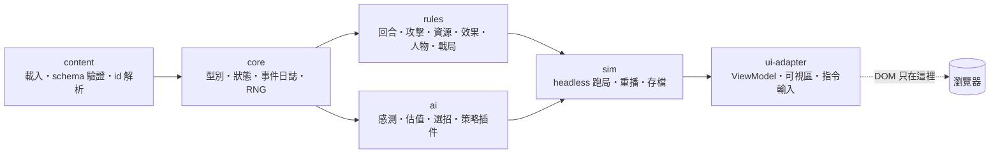

# core — 網頁機甲 SRPG 核心引擎 spec（第一版）

[planning](../../../planning.md)｜裁示原文 [design-notes](../../design-notes.md)｜決策 [decisions](../../../decisions.md)｜世界觀提案 [world](../world/README.md)

這份 spec 給實作團隊切線用：讀完要知道每個模組的邊界、每種資料長什麼樣、每條規則怎麼結算、怎麼在 node 裡 headless 測。**世界觀內容、數值平衡、UI 版面不在這裡**；世界觀只借名詞（裂獸、裂縫、遺跡、獵團、潮）。不可違反的裁示抄在 `constraints.json`，兩卷機制表的採用對照在 `adoption.json`，術語在 `glossary.json`（三份都是 wf-table/1 資料檔，查法見 common 的資料檔契約）。

## 目標與非目標

**目標**：一個純 TypeScript、與 DOM 完全分離的回合制戰術引擎——(1) 一切內容是資料：部位佈局、層、資源池、效果、能力、地形、勢力、怪獸族都是 JSON，程式只提供詞彙與結算順序；(2) 三類機甲（機械／生物／古代）、怪獸、駕駛員、機魂都走同一套骨架，差異只在資料；(3) 任何一場戰鬥能用 seed＋指令序列在 node 裡重播出逐位元相同的事件日誌；(4) AI 與玩家共用同一個行動入口與同一份情報模型。

**非目標**：營運層規則（契約、金錢、修理、招募）只留介面掛點；SS／SSS 級內容；視覺呈現細節；程式碼實作（本 spec 只有型別片段）。

## 一句話模型

**人物**（駕駛員或機魂）坐進**機甲**（機體＝body plan＋部件）；機體的每個**部位**是一條有序的**層序列**；機甲與人物各帶零到多個**資源池**；**能力**宣告消耗哪些池、怎麼瞄準、命中後掛哪些**效果**；效果有 scope、時鐘、疊加政策，可從部位**傳導**到人物；AI 讀能力自己宣告的**戰術權重**選招。一切用 id 引用、無硬編碼分支。

## 模組圖

依賴只能往右；`ai` 透過 `rules` 的查詢介面讀狀態，不直接改狀態；`ui-adapter` 是唯一碰 DOM 的模組。細節見 [architecture.md](architecture.md)。

## 子檔導航

<!-- wf-nav -->
| 檔 | 回答什麼 |
|---|---|
| [data-model-people.md](data-model-people.md) | 人物骨架（駕駛員／機魂共用）、屬性、特質、傷勢、士氣、意志軸三用法、座艙關係 |
| [data-model-mech.md](data-model-mech.md) | 機體、body plan、部位、層序列、資源池、部件、機甲實例 |
| [data-model-abilities-effects.md](data-model-abilities-effects.md) | 能力（成本／冷卻／目標／傷害包／效果／AI 權重）、效果（scope／時鐘／疊加／傳導）、NumExpr |
| [data-model-world.md](data-model-world.md) | 地形、地圖、勢力、怪獸族與個體（spawner／molt 可選行為）、情境 |
| [rules-turn-and-actions.md](rules-turn-and-actions.md) | 回合結構、速度排序、Wait、AP 與移動、行動入口與失敗政策 |
| [rules-attack-resolution.md](rules-attack-resolution.md) | 命中、部位選擇、層序列結算、傳導、十分之一規則、傷害修正鏈 |
| [rules-resources-effects.md](rules-resources-effects.md) | 資源更新時機、閾值帶、效果時鐘、疊加、屬性貢獻與撤回 |
| [rules-people.md](rules-people.md) | 士氣階段、傷勢、共鳴、承擔與失控、機魂成長、控制權 |
| [rules-battle-flow.md](rules-battle-flow.md) | 部署、撤離、棄機、捕捉、勝負、戰後延續 |
| [ai.md](ai.md) | 陣營知識、候選生成、戰術權重×需求×目標估值、意圖宣告、可插拔策略 |
| [content-format.md](content-format.md) | 資料夾佈局、id 命名、各類 JSON 範例、「新增 X 要改哪些檔」 |
| [architecture.md](architecture.md) | 模組邊界、事件日誌與重播、seeded RNG、存檔、headless 測試、可視區介面 |

資料檔：`constraints.json`（不可違反清單）、`adoption.json`（機制表採用對照，以 BB 卷 `CMB-/CHR-/AI-/DAT-/SRW-` 與 ToME 卷 `TM-` id 引用）、`glossary.json`（術語）。

## 機制名 ↔ 風格名對照

2026-10-24 裁示：太空歌劇、不要硬科幻。**程式識別字不改**（pool id、tag、事件名、`stock:*` 帳名），內容包 `name`、UI 文字與 spec 敘述用右欄；全表、禁用詞與命名語感在 `content/lore/style.md`（`glossary.json` 23 列）。

| 機制名（識別字） | 風格名（原名） | 衍生詞 |
|---|---|---|
| `heat` 池 | **燼**（熱量） | 燼滯＝性能懲罰帶、燼爆＝部件受損帶、排燼＝散熱器 |
| `charge` 池 | **流光**（電能） | 汲光＝充能、暗下去＝池空 |
| `ammo-*` 池 | **矢**（彈藥） | 殼矢／光矢／追矢／拘束矢；不講口徑 |
| `shield`／`armor` 層 | **光幕**／**殼甲** | 摹殼（摹機）、礦甲（生物系） |
| `sensor` 功能、`perception` | **殼目**（感測／雷達） | 目盲＝感測失準 |
| `conventional-arms` | **鐵翼／鐵龜**（戰機／坦克） | 十分律兵器 |
| `fuel` 池（ops） | **浮料**（氦與電） | 浮芯＝船的動力 |
| `stock:core-*` | **裂晶**（核） | 源潮＝一切能量 |
| `soul`、魂核部件 | **機魂**／魂核（AI） | 野魂、算核、術式 |

## 讀法

實作者按模組切線：先 `core`＋`content`（型別與載入器），再 `rules` 逐檔，`ai` 與 `sim` 可並行，`ui-adapter` 最後。每個子檔結尾都有「替使用者做掉的決定」，使用者可逐條推翻；推翻後只改該節與 `constraints.json` 對應列。

## 替使用者做掉的決定

本檔無；各子檔見各自結尾，彙整在規劃線 REPORT。
