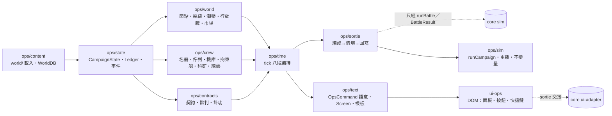

# ops — 營運層 spec（第一版）

[planning](../../../planning.md)｜裁示原文 [design-notes](../../design-notes.md)｜決策 [decisions](../../../decisions.md)｜世界觀 [world](../world/README.md)｜核心引擎 [core](../core/README.md)

核心引擎 spec 只管一場戰鬥；本 spec 管**戰鬥之間的一切**：世界圖與浮船、勢力與聲望、裂縫與蝕域、契約、帳本與市場、科研與機魂練熟、修理與拘束艙（生物系的活捕／屍體改裝、磨損與失控）、人員、潮月時鐘、與戰鬥層的接口、指令語意層與呈現契約（按鈕、列表、面板、快捷鍵）、內容格式、`src/ops/` 的邊界與測試。讀完要能切線實作。不可違反的裁示抄在 `constraints-ops.json`（wf-table/1，每列有來源與對應節，查法見 common 的資料檔契約）。**數值只給量級**；劇情文本、數值平衡、SS／SSS、戰鬥規則不在這裡。

## 目標與非目標

**目標**：(1) 一個純 TS、與 DOM 分離的回合制營運模擬——一天一 tick、二十八天一潮月，世界圖上的裂縫會長、勢力會動、債會到期；(2) 一切內容是資料：節點、路線、裂縫模板、契約模板、事件鏈、對白、房間片語、科研、市場、開局全是 JSON；(3) 與戰鬥層只經 `Sortie → ScenarioDef → runBattle → BattleResult → applyBattleResult` 往來，core 零修改（一欄建議除外）；(4) `OpsCommand` 序列＋seed 可在 node 裡重播整場戰役、跑 N 個潮月不拋錯、帳本守恆可斷言；(5) 每個按鈕對應一個 `OpsCommand`，按鈕、快捷鍵與文字形式三路結果恆等。

**非目標**：戰鬥規則（core）；數值平衡；程式碼；劇情文本（只給格式與樣例）；SS／SSS；改 world／core spec（衝突列 REPORT）。

## 一句話模型

**獵團**（名冊＋浮船）在**世界圖**上移動，每天 `tick()` 結算世界、船務與帳本；玩家開著浮船去任何想去的節點（沙盒、無主線門），用 27 個動詞（按鈕與快捷鍵的語意）看、談、接、派、修、壓、投、陪、航、泊、探、喚、出戰；**裂縫**是會長的狀態機，**契約**是對它的反應，**帳本**是所有錢與存量的唯一入口；出戰把營運狀態以 Effect 注入情境，戰果以 `BattleResult` 回寫。

## 模組圖

依賴只能往右；`ops/*` 不 import `rules`／`ai`。細節見 [architecture-ops.md](architecture-ops.md)。

## 與 core 的接口一句

營運層把 `Sortie` 翻成 `ScenarioDef`（含注入的 Effect）交給 `sim.runBattle`，只拿 `BattleResult` 回寫；core 型別（`MechState`、`PersonState`、`PoolDecl`、`Effect`、`Cond`、`NumExpr`）原樣沿用，不複製一套。

## 子檔導航

<!-- wf-nav -->
| 檔 | 回答什麼 |
|---|---|
| [data-model-world-map.md](data-model-world-map.md) | 節點與路線、蝕域是節點狀態、裂縫七態狀態機、潮壓、浮船、遺跡入口、地月渡輪 |
| [data-model-factions-contracts.md](data-model-factions-contracts.md) | FactionOpsDef 與逐勢力聲望、契約模板與生命週期、談判、世界行動牌、競爭獵團 |
| [data-model-economy-research.md](data-model-economy-research.md) | 帳本（唯一入口、守恆）、庫存、市場與價格、債與催收、科研、機魂「開／練熟」、育魂 |
| [data-model-roster-repair.md](data-model-roster-repair.md) | 名冊、薪水與 mood、招募、休養、工時佇列（修理／重建／移植／育魂／拘束維護）、機庫、古代機甲的認主與命名 |
| [data-model-beasts.md](data-model-beasts.md) | 生物系營運：拘束艙、活捕（磨損、失控、同調、族行為）、族別維持（吞屍／潮浸／修剪）、屍體改裝、登記號／小名／凶名／二名 |
| [time-and-tick.md](time-and-tick.md) | 曆、tick 八段順序、大潮與弦月、跨日逐日補算、長程時鐘量級、終局 |
| [battle-interface.md](battle-interface.md) | 出戰編成→情境生成→戰果回寫（回寫欄位清單）、與 core 的差異 |
| [text-ui-contract.md](text-ui-contract.md) | OpsCommand 語意層（27 個動詞）、快捷鍵 keymap、房間與狀態片語、對白與事件、`Screen` 按鈕／列表契約、戰場入口 |
| [content-format-ops.md](content-format-ops.md) | `content/<pack>/world/` 佈局、每種資料一個 JSON 範例、「新增 X 要改哪些檔」 |
| [architecture-ops.md](architecture-ops.md) | `src/ops/` 模組與依賴、CampaignState 與事件、重播、存檔、六類 headless 測試 |
| [data-model-operations-war.md](data-model-operations-war.md) | 勢力自主作戰：常備軍與分遣隊（地圖上會動）、作戰十種、階段、抽象結算、tick 第 2 段順序、古代殼的爭奪 |
| [data-model-diplomacy.md](data-model-diplomacy.md) | 勢力間關係值＋六態、條約（停火／同盟／代理…）、變化驅動、防退化三閘、與 core 戰場陣營的銜接 |
| [mercenary-contracts.md](mercenary-contracts.md) | 參戰型契約 `join`：友軍 slot 與指揮權三式、勢力補給四檔、軍令與結算、選邊與背叛、作戰情境生成 |
| [data-model-faction-rnd.md](data-model-faction-rnd.md) | 勢力研發推進：藍本血統、通用系列、ModelDef 機型池隨時間擴大（部隊／市場／敵方）、技術流出 |
| [war-testing.md](war-testing.md) | 上四檔的 headless 測試：單元、24 潮月模擬、不退化不變量、五條黃金戰役 |

資料檔：`constraints-ops.json`（不可違反清單，欄位 `id`／`source`／`constraint`／`spec_section`／`note`）、`operations-kinds.json`（作戰十種）、`diplomacy-drivers.json`（外交驅動 17 列）。

## 讀法

實作按模組切線：先 `ops/state`＋`ops/content`（型別、帳本、載入器），再 `ops/world` 與 `ops/crew` 並行，`ops/contracts`→`ops/time`→`ops/sortie`，`ops/text` 可與 `ops/time` 並行，`ops/sim` 最後收攏；第二輪 `ops/war`（作戰、外交、研發）接在 `ops/world` 之後，位置一律經 `Loc` 抽象（方格大地圖落地後不改）。每個子檔結尾都有「替使用者做掉的決定」，可逐條推翻；推翻後只改該節與 `constraints-ops.json` 對應列。

## 替使用者做掉的決定

本檔無；各子檔見各自結尾，彙整在規劃線 REPORT。
