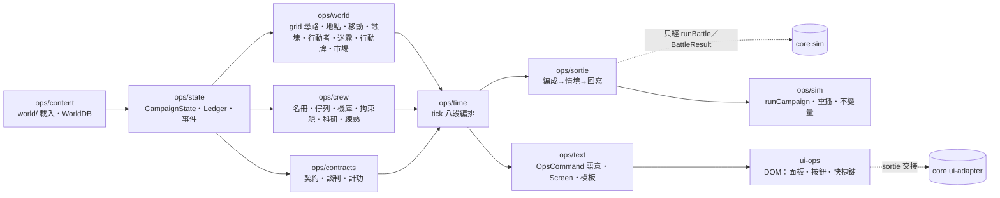

# ops／overview — 營運層的目標與非目標、模組圖、讀法（切線順序）

[ops README](README.md)｜模組細節 [architecture-ops](architecture-ops.md)｜核心引擎 [core](../core/README.md)

## 目標與非目標

**目標**：(1) 一個純 TS、與 DOM 分離的回合制營運模擬——一天一 tick、二十八天一蝕月，世界圖上的裂縫會長、勢力會動、債會到期；(2) 一切內容是資料：六張方格圖、地點、航道、裂縫模板、契約模板、事件鏈、對白、房間片語、科研、市場、開局全是 JSON；(3) 與戰鬥層只經 `Sortie → ScenarioDef → runBattle → BattleResult → applyBattleResult` 往來，core 零修改（一欄建議除外）；(4) `OpsCommand` 序列＋seed 可在 node 裡重播整場戰役、跑 N 個蝕月不拋錯、帳本守恆可斷言；(5) 每個按鈕對應一個 `OpsCommand`，按鈕、快捷鍵與文字形式三路結果恆等。

**非目標**：戰鬥規則（core）；數值平衡；程式碼；劇情文本（只給格式與樣例）；SS／SSS；改 world／core spec（衝突列 REPORT）。

## 模組圖

依賴只能往右；`ops/*` 不 import `rules`／`ai`。細節見 [architecture-ops.md](architecture-ops.md)。

## 讀法

實作按模組切線：先 `ops/state`＋`ops/content`（型別、帳本、載入器），再 `ops/world` 與 `ops/crew` 並行，`ops/contracts`→`ops/time`→`ops/sortie`，`ops/text` 可與 `ops/time` 並行，`ops/sim` 最後收攏；第二輪 `ops/war`（作戰、外交、研發）接在 `ops/world` 之後，位置一律經 `Loc` 抽象；第三輪 world-grid 七段切線（`grid`→`move`／`places`→蝕塊→`actors`／`fog`→收尾→正式圖→大地圖 UI）在 [migration-and-testing](world-grid/migration-and-testing.md)。每個子檔結尾都有「替使用者做掉的決定」，可逐條推翻；推翻後只改該節與 `constraints-ops.json` 對應列。
